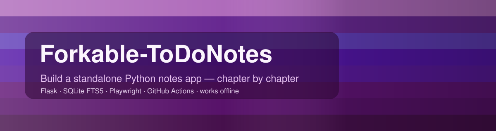
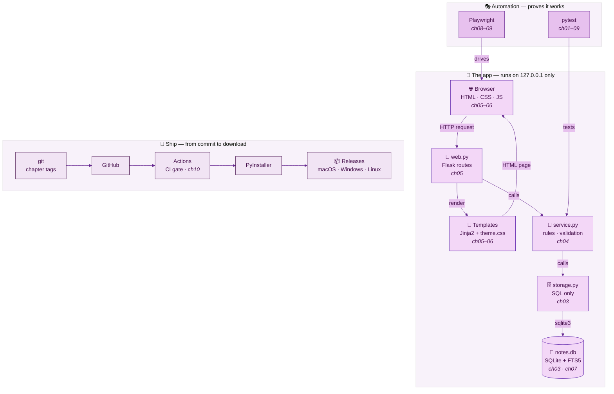

<p align="center">
  
</p>

<p align="center">
  
  
  
  
  
  
  
  
</p>

<h3 align="center">📝 A standalone notes + to-do app in Python — and the step-by-step course that builds it.</h3>

<p align="center"><i>Read a chapter · run the code · <code>git switch --detach chNN</code> to see exactly what that chapter built.</i></p>

> *⭐ If a `Forkable*` repo saves you an afternoon, a star helps someone else find it.*

---

## 👋 At a glance

| Info | Details |
|---|---|
| 🎯 **What** | A notes app with checklists, instant search and a purple light/dark theme — running in your browser, served from your own computer |
| 📚 **How you learn** | **5 sections · 12 chapters**, each ending in a Git tag (`ch00` … `ch11`) you can check out |
| 🧰 **Stack** | `Python` `Flask` `Jinja2` `Waitress` `SQLite FTS5` `HTML` `CSS` `JS` `pytest` `Playwright` `GitHub Actions` `PyInstaller` |
| 💻 **Runs on** | 🍎 macOS · 🪟 Windows · 🐧 Linux — Python 3.10 or newer |
| 🔒 **Privacy** | Listens on `127.0.0.1` only. No account, no cloud, no analytics — and a test proves nothing leaves your machine |
| 🗺️ **Part of** | The [`Forkable*` index](https://github.com/suryakulshreshtha/SuryaKulshreshtha) — clone it, run it, keep it or throw it away |

## ⚡ Quick start

<table>
<tr><th width="50%">🍎 macOS · Terminal (zsh)</th><th width="50%">🪟 Windows · PowerShell</th></tr>
<tr>
<td>

```bash
git clone https://github.com/suryakulshreshtha/Forkable-ToDoNotes.git
cd Forkable-ToDoNotes
python3 -m venv .venv
source .venv/bin/activate
python -m pip install -r requirements.txt
python -m todonotes          # opens http://127.0.0.1:8765/
```

</td>
<td>

```powershell
git clone https://github.com/suryakulshreshtha/Forkable-ToDoNotes.git
cd Forkable-ToDoNotes
py -m venv .venv
.venv\Scripts\Activate.ps1
python -m pip install -r requirements.txt
python -m todonotes          # opens http://127.0.0.1:8765/
```

</td>
</tr>
</table>

Stop it with **Ctrl+C**. Your notes are kept in one SQLite file in your user data folder
(details in [Chapter 03](docs/section-2-data-and-logic/chapter-03-sqlite-storage.md)).


## 🗺️ How it fits together



<sub>🖼️ Offline copy: [tech-map.svg](docs/diagrams/tech-map.svg) · source: [tech-map.mmd](docs/diagrams/tech-map.mmd)</sub>

## 📚 Learning path — sections and chapters

### 🧭 Section 1 · Orientation

| Chapter | What you'll build | Stack | Tag |
|---|---|---|---|
| **[00 · How to read this repo](docs/section-1-orientation/chapter-00-how-to-read-this-repo.md)** | The map, the conventions, following along with tags | `Git` `Markdown` | `ch00` |
| **[01 · Setup: Python, Git, venv](docs/section-1-orientation/chapter-01-setup-python-git-and-venv.md)** | A working toolchain on 🍎 and 🪟, an installable package, the first test | `Python` `pip` `venv` `pytest` `ruff` | `ch01` |
| **[02 · Architecture & data flow](docs/section-1-orientation/chapter-02-architecture-and-data-flow.md)** | Layers, Mermaid diagrams, documentation that is tested | `Mermaid` `pytest` | `ch02` |

### 🗄️ Section 2 · Data & logic

| Chapter | What you'll build | Stack | Tag |
|---|---|---|---|
| **[03 · SQLite storage](docs/section-2-data-and-logic/chapter-03-sqlite-storage.md)** | Schema, migrations, parameters, per-OS data folder | `SQLite` `sqlite3` | `ch03` |
| **[04 · Service layer & unit tests](docs/section-2-data-and-logic/chapter-04-service-layer-and-unit-tests.md)** | Business rules, fixtures, parametrize, markers | `Python` `pytest` | `ch04` |

### 🎨 Section 3 · Web UI

| Chapter | What you'll build | Stack | Tag |
|---|---|---|---|
| **[05 · Flask routes & templates](docs/section-3-web-ui/chapter-05-flask-routes-and-templates.md)** | Pages, forms, JSON API, local-only safety checks | `Flask` `Jinja2` `Waitress` | `ch05` |
| **[06 · Design system: CSS & JS](docs/section-3-web-ui/chapter-06-design-system-css-and-js.md)** | Purple palette tokens, light/dark, contrast tests, autosave | `CSS` `JavaScript` `WCAG` | `ch06` |
| **[07 · Full-text search (FTS5)](docs/section-3-web-ui/chapter-07-full-text-search-fts5.md)** | Prefix search, ranking, safe `<mark>` highlights | `SQLite FTS5` `MarkupSafe` | `ch07` |


### 📌 Suggested reading order

```text
Section 1  🧭  00 → 01 → 02     read the map, set up, see the whole design
Section 2  🗄️  03 → 04          data first, rules second (no web yet!)
Section 3  🎨  05 → 06 → 07     pages, then looks, then search
Section 4  🎭  08 → 09          prove it works in a real browser
Section 5  🚀  10 → 11          ship it, then make it yours
```

Full index with time estimates: **[📚 docs/README.md](docs/README.md)**.

## 🗂️ Repository map

Files arrive chapter by chapter — the right-hand column says when.

```text
Forkable-ToDoNotes/
├── src/todonotes/          the app
│   ├── __main__.py         launcher: picks a port, starts Waitress, opens the browser   (ch01, ch05)
│   ├── config.py           where notes.db lives on each OS                             (ch03)
│   ├── models.py           Note · ChecklistItem · SearchHit                             (ch03, ch07)
│   ├── storage.py          all SQL: migrations, CRUD, FTS5 search                       (ch03, ch07)
│   ├── service.py          rules: validation, defaults, export                          (ch04)
│   ├── web.py              Flask routes, JSON API, safety checks                        (ch05)
│   ├── templates/          Jinja HTML                                                   (ch05)
│   └── static/             theme.css · app.css · app.js                                 (ch06)
├── tests/unit/             fast tests — no browser                                      (ch01 → ch07)
├── tests/e2e/              Playwright tests + page objects                              (ch08, ch09)
├── scripts/                contrast check · screenshots · build · dependency audit
├── packaging/launch.py     PyInstaller entry point                                      (ch10)
├── .github/                CI, release workflow, issue/PR templates, Dependabot         (ch10, ch11)
└── docs/                   📚 the course: sections → chapters, diagrams, assets
```

## 🤝 Community

- 🤝 [Contributing](CONTRIBUTING.md) — branch, test, Conventional Commits
- 🔐 [Security policy](SECURITY.md) — what the app protects, how to report a problem
- 🤖 [Rules for AI coding agents](AGENTS.md) — may address reviews, fix CI and resolve conflicts; **never merge**
- 💜 [Code of conduct](CODE_OF_CONDUCT.md)

## 🔗 More `Forkable*` repos

| Repo | What it is |
|---|---|
| [ForkablePythonLearningShowcase](https://github.com/suryakulshreshtha/ForkablePythonLearningShowcase) | Test automation fundamentals, built up step by step |
| [Forkable04EyePythonPlaywrightLearning](https://github.com/suryakulshreshtha/Forkable04EyePythonPlaywrightLearning) | E2E testing workflows wired to GitHub Actions CI |
| [ForkablePythonProjectShowcase](https://github.com/suryakulshreshtha/ForkablePythonProjectShowcase) | A full UI + API test automation framework |
| [🗺️ The full index](https://github.com/suryakulshreshtha/SuryaKulshreshtha) | Every `Forkable*` repo and the order to read them in |

---

<p align="center">📄 <a href="LICENSE">MIT licence</a> · 🌐 <a href="https://github.com/suryakulshreshtha">@suryakulshreshtha</a></p>
