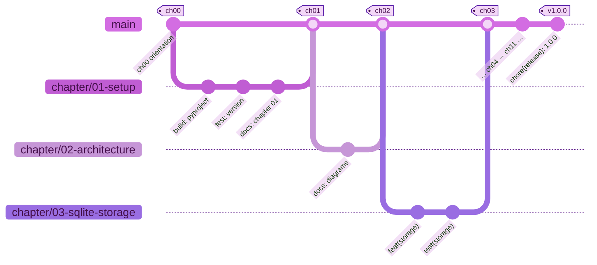

# 🌿 Git guide — every command, side by side

> Git commands are **the same** on macOS and Windows — the *shell* around them
> is what differs (paths, environment variables, quoting). Each step shows both,
> so you can copy without translating.



<sub>🖼️ Offline copy: [git-chapters.svg](diagrams/git-chapters.svg) · source: [git-chapters.mmd](diagrams/git-chapters.mmd)</sub>

## 1 · First-time setup (once per computer)

<table>
<tr><th width="50%">🍎 macOS · Terminal (zsh)</th><th width="50%">🪟 Windows · PowerShell</th></tr>
<tr>
<td>

```bash
git config --global user.name "Your Name"
git config --global user.email "ID+username@users.noreply.github.com"   # masked
git config --global init.defaultBranch main
git config --list --show-origin
```

</td>
<td>

```powershell
git config --global user.name "Your Name"
git config --global user.email "ID+username@users.noreply.github.com"   # masked
git config --global init.defaultBranch main
git config --list --show-origin
```

</td>
</tr>
<tr><td colspan="2" align="center">✅ <b>Same command on both</b> — Git and pip behave identically here; only the shell differs.</td></tr>
</table>

Find your masked address in GitHub **Settings → Emails** after ticking **Keep my email address private**.

## 2 · Get the code

<table>
<tr><th width="50%">🍎 macOS · Terminal (zsh)</th><th width="50%">🪟 Windows · PowerShell</th></tr>
<tr>
<td>

```bash
git clone https://github.com/suryakulshreshtha/Forkable-ToDoNotes.git
cd Forkable-ToDoNotes
git status
```

</td>
<td>

```powershell
git clone https://github.com/suryakulshreshtha/Forkable-ToDoNotes.git
cd Forkable-ToDoNotes
git status
```

</td>
</tr>
<tr><td colspan="2" align="center">✅ <b>Same command on both</b> — Git and pip behave identically here; only the shell differs.</td></tr>
</table>

## 3 · The daily loop

<table>
<tr><th width="50%">🍎 macOS · Terminal (zsh)</th><th width="50%">🪟 Windows · PowerShell</th></tr>
<tr>
<td>

```bash
git status                      # what changed?
git diff                        # show the changes
git add src/todonotes/web.py    # stage one file (or: git add .)
git commit -m "feat(web): add stats endpoint"
git log --oneline --graph --decorate -15
```

</td>
<td>

```powershell
git status                      # what changed?
git diff                        # show the changes
git add src/todonotes/web.py    # stage one file (or: git add .)
git commit -m "feat(web): add stats endpoint"
git log --oneline --graph --decorate -15
```

</td>
</tr>
<tr><td colspan="2" align="center">✅ <b>Same command on both</b> — Git and pip behave identically here; only the shell differs.</td></tr>
</table>

## 4 · The chapter workflow used in this repo

<table>
<tr><th width="50%">🍎 macOS · Terminal (zsh)</th><th width="50%">🪟 Windows · PowerShell</th></tr>
<tr>
<td>

```bash
git switch -c chapter/05-flask-routes      # 1. branch
# ... edit, test ...
git add .
git commit -m "feat(web): routes and templates"   # 2. commit (repeat)
git switch main
git merge --no-ff chapter/05-flask-routes -m "Merge chapter 05: Flask routes and templates"
git tag -a ch05 -m "Chapter 05 checkpoint"  # 3. tag
git branch -d chapter/05-flask-routes       # 4. tidy up
```

</td>
<td>

```powershell
git switch -c chapter/05-flask-routes      # 1. branch
# ... edit, test ...
git add .
git commit -m "feat(web): routes and templates"   # 2. commit (repeat)
git switch main
git merge --no-ff chapter/05-flask-routes -m "Merge chapter 05: Flask routes and templates"
git tag -a ch05 -m "Chapter 05 checkpoint"  # 3. tag
git branch -d chapter/05-flask-routes       # 4. tidy up
```

</td>
</tr>
<tr><td colspan="2" align="center">✅ <b>Same command on both</b> — Git and pip behave identically here; only the shell differs.</td></tr>
</table>

## 5 · Travel between chapters

<table>
<tr><th width="50%">🍎 macOS · Terminal (zsh)</th><th width="50%">🪟 Windows · PowerShell</th></tr>
<tr>
<td>

```bash
git tag --list "ch*"
git switch --detach ch07        # read/run Chapter 07's code
git switch -c play ch07         # …or start your own branch there
git switch main                 # back to the latest
git diff ch06 ch07 --stat       # what Chapter 07 changed
```

</td>
<td>

```powershell
git tag --list "ch*"
git switch --detach ch07        # read/run Chapter 07's code
git switch -c play ch07         # …or start your own branch there
git switch main                 # back to the latest
git diff ch06 ch07 --stat       # what Chapter 07 changed
```

</td>
</tr>
<tr><td colspan="2" align="center">✅ <b>Same command on both</b> — Git and pip behave identically here; only the shell differs.</td></tr>
</table>

## 6 · Publish to GitHub (first push)

Create an **empty** repository on GitHub first (no README, no licence — this repo already has them).

<table>
<tr><th width="50%">🍎 macOS · Terminal (zsh)</th><th width="50%">🪟 Windows · PowerShell</th></tr>
<tr>
<td>

```bash
git remote add origin https://github.com/YOUR-USER/Forkable-ToDoNotes.git
git push -u origin main
git push origin --tags          # tags are NOT pushed by default
```

</td>
<td>

```powershell
git remote add origin https://github.com/YOUR-USER/Forkable-ToDoNotes.git
git push -u origin main
git push origin --tags          # tags are NOT pushed by default
```

</td>
</tr>
<tr><td colspan="2" align="center">✅ <b>Same command on both</b> — Git and pip behave identically here; only the shell differs.</td></tr>
</table>

## 7 · Where macOS and Windows really differ

| Task | 🍎 macOS (zsh) | 🪟 Windows (PowerShell) |
|---|---|---|
| Set an env var for one command | `TODONOTES_DB=/tmp/n.db python -m todonotes` | `$env:TODONOTES_DB="C:\temp\n.db"; python -m todonotes` |
| Path separator | `src/todonotes/web.py` | `src\todonotes\web.py` (Git accepts `/` too) |
| Activate the venv | `source .venv/bin/activate` | `.venv\Scripts\Activate.ps1` |
| Open a folder | `open .` | `explorer .` |
| Delete a folder | `rm -rf build` | `Remove-Item -Recurse -Force build` |
| Line continuation | `\` | `` ` `` (backtick) |
| Line endings in files | LF | CRLF by default — normalised to LF by [`.gitattributes`](../.gitattributes) |

## 8 · Undo, safely

<table>
<tr><th width="50%">🍎 macOS · Terminal (zsh)</th><th width="50%">🪟 Windows · PowerShell</th></tr>
<tr>
<td>

```bash
git restore src/todonotes/web.py     # throw away unstaged edits to one file
git restore --staged .               # unstage everything (keeps your edits)
git commit --amend                   # fix the LAST commit (only if not pushed)
git revert <commit>                  # undo a pushed commit with a new commit
```

</td>
<td>

```powershell
git restore src/todonotes/web.py     # throw away unstaged edits to one file
git restore --staged .               # unstage everything (keeps your edits)
git commit --amend                   # fix the LAST commit (only if not pushed)
git revert <commit>                  # undo a pushed commit with a new commit
```

</td>
</tr>
<tr><td colspan="2" align="center">✅ <b>Same command on both</b> — Git and pip behave identically here; only the shell differs.</td></tr>
</table>

## 📚 Sources

- [Pro Git book](https://git-scm.com/book/en/v2) — especially [First-time setup](https://git-scm.com/book/en/v2/Getting-Started-First-Time-Git-Setup), [Branching and merging](https://git-scm.com/book/en/v2/Git-Branching-Basic-Branching-and-Merging) and [Tagging](https://git-scm.com/book/en/v2/Git-Basics-Tagging)
- Git reference — [git switch](https://git-scm.com/docs/git-switch) · [git merge](https://git-scm.com/docs/git-merge) · [git restore](https://git-scm.com/docs/git-restore) · [git revert](https://git-scm.com/docs/git-revert) · [gitattributes](https://git-scm.com/docs/gitattributes)
- GitHub Docs — [Email addresses reference (noreply address)](https://docs.github.com/en/account-and-profile/reference/email-addresses-reference)
- [Conventional Commits 1.0.0](https://www.conventionalcommits.org/en/v1.0.0/)

[⬅️ Learning path](README.md)
