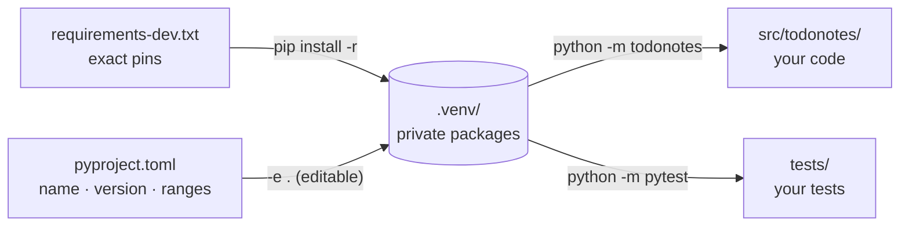
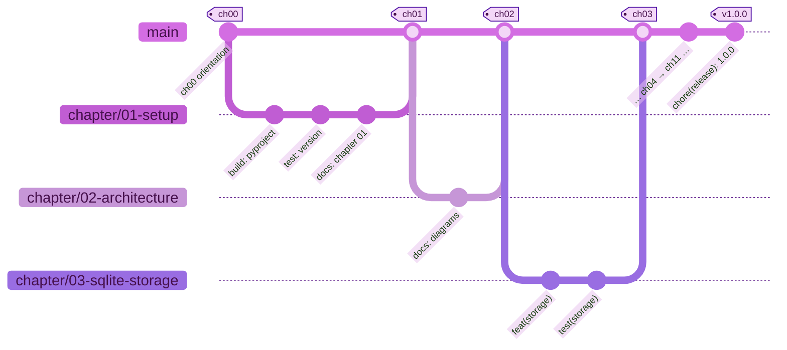

# 🧰 Chapter 01 · Setup: Python, Git and a virtual environment

> **Section 1 · Orientation** · ⏱️ 45 min · 🏷️ checkpoint tag: `ch01`

## 🎯 Goal

A working toolchain on **macOS** and **Windows**: Python 3.10+, Git with your identity,
an isolated *virtual environment*, and a tiny installable package whose first test passes.

```text
python -m todonotes --version   →   Forkable-ToDoNotes 0.1.0
python -m pytest                →   3 passed
```

## 🧠 Concepts

| Idea | In one sentence |
|---|---|
| **Python version** | We support 3.10 and newer; CI tests 3.10 *and* 3.13 so both ends stay honest. |
| **Virtual environment (venv)** | A private folder of packages for *this* project, so projects never fight over versions. |
| **`pyproject.toml`** | One file that tells every tool (pip, pytest, ruff) what the project is and how to treat it. |
| **Editable install (`-e .`)** | Installs the package as a *link* to `src/`, so your edits take effect without reinstalling. |
| **Ranges vs pins** | `pyproject.toml` says what we are *compatible* with (`flask>=3.1,<4`); `requirements.txt` says what we *tested* (`flask==3.1.3`). |
| **`src/` layout** | Code lives in `src/todonotes/`, so tests always import the *installed* package, never a stray folder. |

## 🗺️ Diagram — how the pieces connect



## 🛠️ Build it

### Step 1 — Install Python 3.10 or newer

<table>
<tr><th width="50%">🍎 macOS · Terminal (zsh)</th><th width="50%">🪟 Windows · PowerShell</th></tr>
<tr>
<td>

```bash
# Check what you have (macOS ships an older /usr/bin/python3 on some versions)
python3 --version

# If it is older than 3.10: download the macOS installer from
#   https://www.python.org/downloads/
# then run "Install Certificates.command" from the new
# /Applications/Python 3.x/ folder (enables HTTPS for pip).
python3 --version
```

</td>
<td>

```powershell
# Check what you have
py --version

# If "py" is missing or older than 3.10, install the Python
# install manager from https://www.python.org/downloads/
# (or the Microsoft Store), then:
py install 3.13
py --version
```

</td>
</tr>
</table>

> [!NOTE]
> On macOS the command is **`python3`** until a virtual environment is active.
> On Windows the **`py`** command comes with the Python install manager and picks the right version for you.

### Step 2 — Install Git and tell it who you are

<table>
<tr><th width="50%">🍎 macOS · Terminal (zsh)</th><th width="50%">🪟 Windows · PowerShell</th></tr>
<tr>
<td>

```bash
# Apple's Command Line Tools include Git:
xcode-select --install
# (or, with Homebrew: brew install git)

git --version
```

</td>
<td>

```powershell
# Git for Windows installer: https://git-scm.com/install/windows
# or with winget:
winget install --id Git.Git -e --source winget

git --version
```

</td>
</tr>
</table>

Your name and e-mail are stamped on every commit you make. Set them once per computer:

<table>
<tr><th width="50%">🍎 macOS · Terminal (zsh)</th><th width="50%">🪟 Windows · PowerShell</th></tr>
<tr>
<td>

```bash
git config --global user.name "Your Name"
git config --global user.email "you@example.com"
git config --global init.defaultBranch main
git config --list --show-origin   # check what is set, and where
```

</td>
<td>

```powershell
git config --global user.name "Your Name"
git config --global user.email "you@example.com"
git config --global init.defaultBranch main
git config --list --show-origin   # check what is set, and where
```

</td>
</tr>
<tr><td colspan="2" align="center">✅ <b>Same command on both</b> — Git and pip behave identically here; only the shell differs.</td></tr>
</table>

> [!TIP]
> **Keep your real e-mail private.** In GitHub **Settings → Emails**, tick **Keep my email address private**
> and use the masked address it shows — `ID+username@users.noreply.github.com` — as `user.email`.
> The ID-based form stays linked to your account even if you rename it later. This repository's own
> commits use the author's masked address.

### Step 3 — Create and activate a virtual environment

From the repository folder:

<table>
<tr><th width="50%">🍎 macOS · Terminal (zsh)</th><th width="50%">🪟 Windows · PowerShell</th></tr>
<tr>
<td>

```bash
python3 -m venv .venv
source .venv/bin/activate
# your prompt now starts with (.venv)
python --version     # "python" now means the venv's Python
```

</td>
<td>

```powershell
py -m venv .venv
.venv\Scripts\Activate.ps1
# your prompt now starts with (.venv)
python --version     # "python" now means the venv's Python
```

</td>
</tr>
</table>

> [!WARNING]
> **Windows:** if PowerShell says *"running scripts is disabled on this system"*, allow
> local scripts for your user once, then activate again:
> `Set-ExecutionPolicy -ExecutionPolicy RemoteSigned -Scope CurrentUser`

### Step 4 — Describe the project: `pyproject.toml`

<!-- snippet: pyproject.toml -->
```toml
[build-system]
requires = ["setuptools>=77"]
build-backend = "setuptools.build_meta"

[project]
name = "forkable-todonotes"
dynamic = ["version"]   # read from src/todonotes/__init__.py (single source of truth)
requires-python = ">=3.10"
license = "MIT"

[project.scripts]
todonotes = "todonotes.__main__:main"
```

**Why it is written this way**

- `dynamic = ["version"]` + `[tool.setuptools.dynamic]` read the version from **one** place,
  `src/todonotes/__init__.py`, so the CLI, the footer and the package can never disagree.
- `[project.scripts]` creates a `todonotes` command when the package is installed.
- `license = "MIT"` is an SPDX expression — the modern form the packaging spec asks for.

### Step 5 — The smallest useful program

[`src/todonotes/__main__.py`](../../src/todonotes/__main__.py) makes `python -m todonotes` work.
In this chapter it only answers `--version`; Chapter 05 turns it into the app launcher.

<!-- snippet: src/todonotes/__main__.py -->
```python
def build_parser() -> argparse.ArgumentParser:
    parser = argparse.ArgumentParser(
        prog="todonotes",
        description=f"{APP_NAME}: a standalone, offline-first notes + to-do app.",
    )
    parser.add_argument("--version", action="version", version=f"{APP_NAME} {__version__}")
```

### Step 6 — Install everything, then run the first test

<table>
<tr><th width="50%">🍎 macOS · Terminal (zsh)</th><th width="50%">🪟 Windows · PowerShell</th></tr>
<tr>
<td>

```bash
python -m pip install -r requirements-dev.txt
python -m todonotes --version
python -m pytest
```

</td>
<td>

```powershell
python -m pip install -r requirements-dev.txt
python -m todonotes --version
python -m pytest
```

</td>
</tr>
<tr><td colspan="2" align="center">✅ <b>Same command on both</b> — Git and pip behave identically here; only the shell differs.</td></tr>
</table>

`requirements-dev.txt` starts with `-r requirements.txt`, which ends with `-e .` —
so one command installs the test tools **and** your package in editable mode.

## ▶️ Run it

<table>
<tr><th width="50%">🍎 macOS · Terminal (zsh)</th><th width="50%">🪟 Windows · PowerShell</th></tr>
<tr>
<td>

```bash
python -m todonotes --help
ruff check .            # lint: likely bugs, unused imports, import order
ruff format --check .   # formatting: report only, change nothing
deactivate              # leave the venv when you are done
```

</td>
<td>

```powershell
python -m todonotes --help
ruff check .            # lint: likely bugs, unused imports, import order
ruff format --check .   # formatting: report only, change nothing
deactivate              # leave the venv when you are done
```

</td>
</tr>
<tr><td colspan="2" align="center">✅ <b>Same command on both</b> — Git and pip behave identically here; only the shell differs.</td></tr>
</table>

## 🌿 Git checkpoint

Every chapter follows the same rhythm: **branch → commit → merge → tag**.



<sub>🖼️ Offline copy: [git-chapters.svg](../diagrams/git-chapters.svg) · source: [git-chapters.mmd](../diagrams/git-chapters.mmd)</sub>

<table>
<tr><th width="50%">🍎 macOS · Terminal (zsh)</th><th width="50%">🪟 Windows · PowerShell</th></tr>
<tr>
<td>

```bash
git switch -c chapter/01-setup
git add pyproject.toml requirements.txt requirements-dev.txt src tests
git commit -m "build: add pyproject, pinned requirements and package skeleton"
git switch main
git merge --no-ff chapter/01-setup -m "Merge chapter 01: setup"
git tag -a ch01 -m "Chapter 01 checkpoint: setup"
git branch -d chapter/01-setup
```

</td>
<td>

```powershell
git switch -c chapter/01-setup
git add pyproject.toml requirements.txt requirements-dev.txt src tests
git commit -m "build: add pyproject, pinned requirements and package skeleton"
git switch main
git merge --no-ff chapter/01-setup -m "Merge chapter 01: setup"
git tag -a ch01 -m "Chapter 01 checkpoint: setup"
git branch -d chapter/01-setup
```

</td>
</tr>
<tr><td colspan="2" align="center">✅ <b>Same command on both</b> — Git and pip behave identically here; only the shell differs.</td></tr>
</table>

- `--no-ff` always creates a merge commit, so `git log --graph` shows each chapter as its own bubble.
- `-a` makes an **annotated** tag: it records who tagged, when, and a message.
- Commit messages follow **Conventional Commits** (`build:`, `feat:`, `test:`, `docs:`, `ci:` …).

More commands, side by side for both systems: [🌿 GIT-GUIDE.md](../GIT-GUIDE.md).

## 📝 Notes

> [!IMPORTANT]
> Never commit `.venv/`. It is machine-specific and huge; [`.gitignore`](../../.gitignore) already excludes it.
> Anyone can recreate it with the two commands in Step 3 and Step 6.

> [!TIP]
> [`.gitattributes`](../../.gitattributes) stores text files with LF line endings in the repository.
> Without it, a Windows checkout and a macOS checkout can show every line as "changed".

> [!NOTE]
> `python -m pip` (instead of plain `pip`) guarantees you use the pip that belongs to the active Python.

## 🧪 Your turn

1. Run `python -m todonotes --help`. Where does the description text come from?
2. Open [`tests/unit/test_package.py`](../../tests/unit/test_package.py), break the expected text
   on purpose, run `python -m pytest`, and read how pytest explains the failure. Then undo it.
3. Run `git log --oneline --graph --decorate` and find `ch00` and `ch01`.

## 📚 Sources

- Python docs — [Using Python on Windows](https://docs.python.org/3/using/windows.html) (install manager, `py` command)
- Python docs — [Using Python on macOS](https://docs.python.org/3/using/mac.html) (installer, Install Certificates)
- Python docs — [venv](https://docs.python.org/3/library/venv.html) (create/activate per shell, PowerShell execution policy)
- pip docs — [pip install](https://pip.pypa.io/en/stable/cli/pip_install/) and [requirements file format](https://pip.pypa.io/en/stable/reference/requirements-file-format/)
- Python Packaging — [pyproject.toml specification](https://packaging.python.org/en/latest/specifications/pyproject-toml/)
- GitHub Docs — [Email addresses reference (noreply address)](https://docs.github.com/en/account-and-profile/reference/email-addresses-reference) · [Setting your commit email address](https://docs.github.com/en/account-and-profile/setting-up-and-managing-your-personal-account-on-github/managing-email-preferences/setting-your-commit-email-address)
- Git — [Install on macOS](https://git-scm.com/install/mac) · [Install on Windows](https://git-scm.com/install/windows) · [First-time setup](https://git-scm.com/book/en/v2/Getting-Started-First-Time-Git-Setup)
- Git reference — [gitattributes](https://git-scm.com/docs/gitattributes) · [git merge `--no-ff`](https://git-scm.com/docs/git-merge)
- [Conventional Commits 1.0.0](https://www.conventionalcommits.org/en/v1.0.0/)
- pytest — [Get started](https://docs.pytest.org/en/stable/getting-started.html) · Ruff — [formatter](https://docs.astral.sh/ruff/formatter/) and [linter](https://docs.astral.sh/ruff/linter/)

---

[⬅️ Chapter 00](chapter-00-how-to-read-this-repo.md) · [📚 Learning path](../README.md) · Next: Chapter 02 arrives at tag `ch02`.
