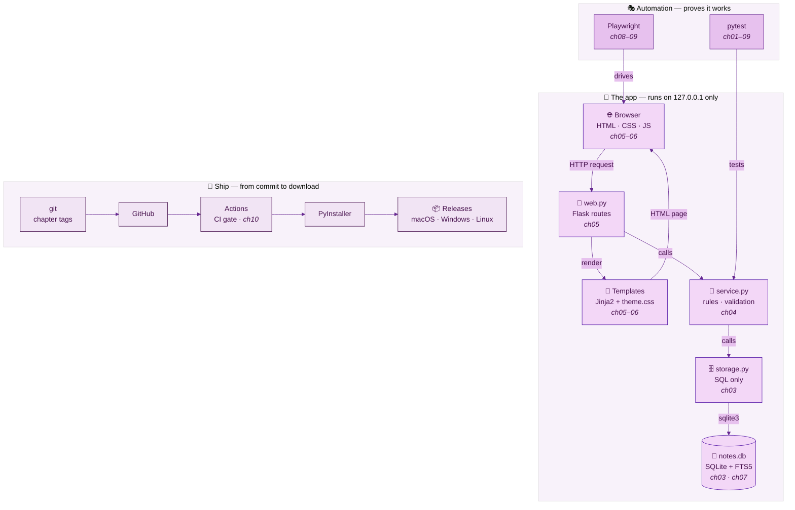
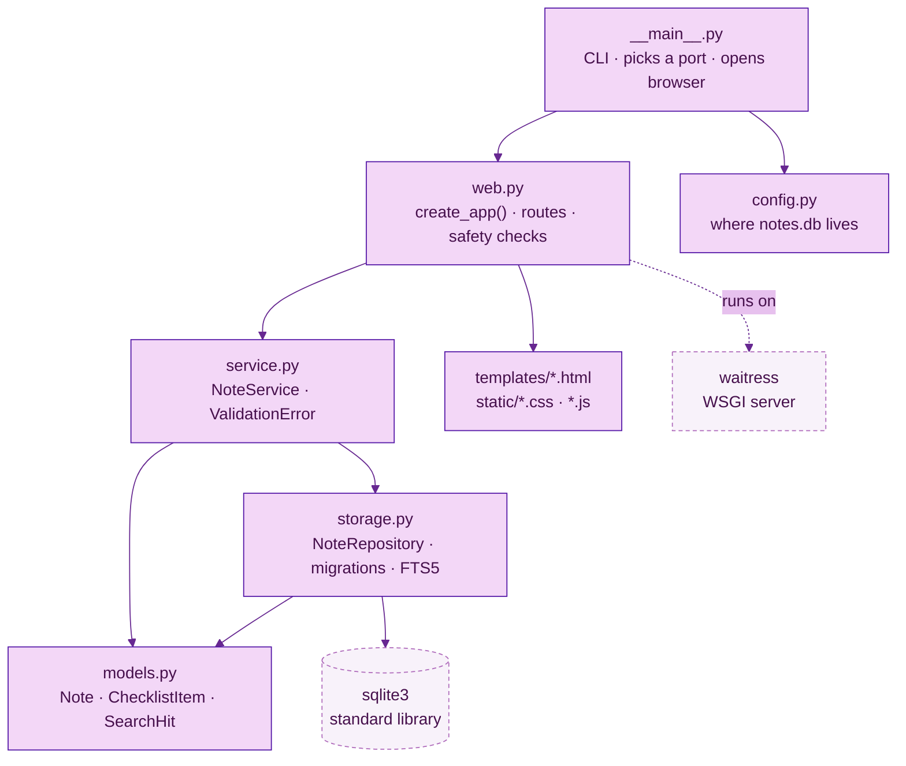
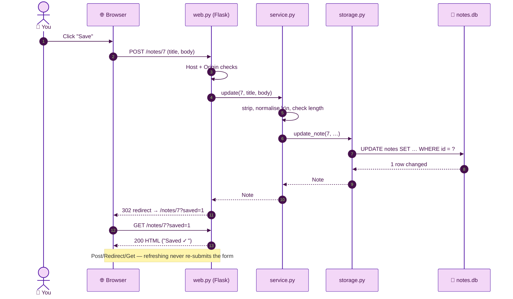
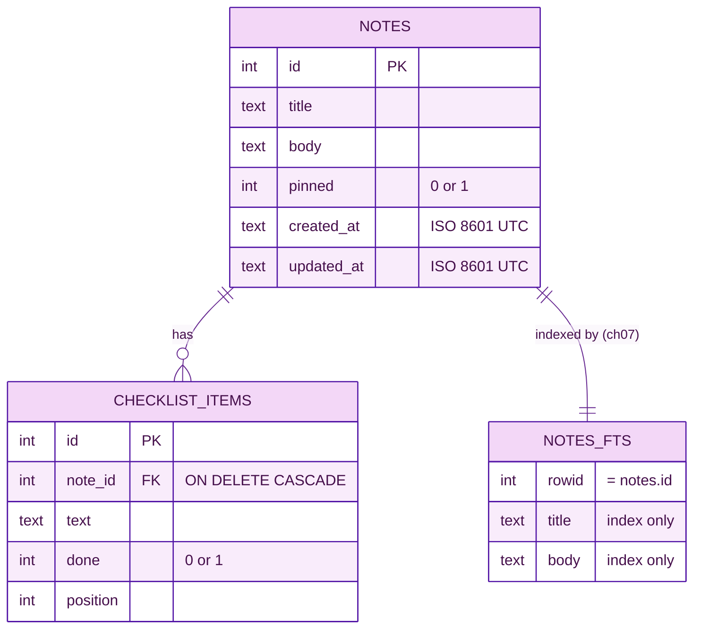

# 🗺️ Chapter 02 · Architecture and data flow

> **Section 1 · Orientation** · ⏱️ 30 min · 🏷️ checkpoint tag: `ch02`

## 🎯 Goal

See the **whole map before building any of it**: which technology does what, which Python
file talks to which, and what happens — step by step — when you press **Save**.
You will also add a test that keeps the documentation honest.

## 🧠 Concepts

**Layers.** The app is three layers stacked like floors of a building. Each floor only
talks to the floor directly below it.

| Layer | File | Knows about | Never touches |
|---|---|---|---|
| 🌐 Web | `web.py` + `templates/` | HTTP, forms, HTML, JSON | SQL |
| 🧠 Service | `service.py` | Rules: lengths, defaults, "not found" | HTTP, SQL |
| 🗄️ Storage | `storage.py` | SQL and the SQLite file | HTTP, rules |
| 📦 Models | `models.py` | Plain data shapes (`Note`, `ChecklistItem`) | Everything else |

Why bother? Because each layer can be **tested alone** (storage in Chapter 03, rules in 04,
pages in 05) and **replaced alone** (swap SQLite for something else and the web layer never notices).

**Diagrams as code.** Every diagram is a few lines of [Mermaid](https://mermaid.js.org/intro/)
text in [`docs/diagrams/`](../diagrams/). GitHub draws them in the browser; an `.svg` copy of each
sits next to it so the docs also work offline.

## 🗺️ The technology map



<sub>🖼️ Offline copy: [tech-map.svg](../diagrams/tech-map.svg) · source: [tech-map.mmd](../diagrams/tech-map.mmd)</sub>

| Technology | Role in this project | Chapter | Official docs |
|---|---|---|---|
| 🐍 Python 3.10+ | The language for everything except the page's look | 01 | [docs.python.org](https://docs.python.org/3/) |
| 🗄️ SQLite + `sqlite3` | The database: one file, built into Python | 03 | [sqlite3](https://docs.python.org/3/library/sqlite3.html) |
| 🧪 pytest | Runs every test, unit and browser | 01–09 | [docs.pytest.org](https://docs.pytest.org/en/stable/) |
| 🧭 Flask + Jinja2 | Routes and HTML templates | 05 | [Flask](https://flask.palletsprojects.com/en/stable/) |
| 🍽️ Waitress | Serves the Flask app on `127.0.0.1` | 05 | [Waitress](https://docs.pylonsproject.org/projects/waitress/en/stable/) |
| 💜 CSS + a little JS | Purple design system, autosave, shortcuts | 06 | [MDN](https://developer.mozilla.org/en-US/docs/Web/CSS) |
| 🔎 SQLite FTS5 | Full-text search with ranking and snippets | 07 | [FTS5](https://sqlite.org/fts5.html) |
| 🎭 Playwright | Drives a real browser to prove it all works | 08–09 | [playwright.dev](https://playwright.dev/python/docs/intro) |
| ⚙️ GitHub Actions | Runs the tests on every push; builds releases | 10 | [GitHub Docs](https://docs.github.com/en/actions) |
| 📦 PyInstaller | Turns the app into one double-clickable file | 10 | [pyinstaller.org](https://pyinstaller.org/) |

## 🧩 The module map — who imports whom



<sub>🖼️ Offline copy: [module-map.svg](../diagrams/module-map.svg) · source: [module-map.mmd](../diagrams/module-map.mmd)</sub>

Arrows only point **down**. If you ever feel the urge to `import web` from `storage.py`,
the design is telling you something belongs in a different layer.

## 🔁 Request flow — what happens when you press Save



<sub>🖼️ Offline copy: [request-flow.svg](../diagrams/request-flow.svg) · source: [request-flow.mmd](../diagrams/request-flow.mmd)</sub>

The last step — **redirect, then GET** — is called *Post/Redirect/Get*. Because the browser
ends on a normal GET page, pressing refresh never submits the form a second time.

## 🧱 The data model



<sub>🖼️ Offline copy: [data-model.svg](../diagrams/data-model.svg) · source: [data-model.mmd](../diagrams/data-model.mmd)</sub>

`NOTES_FTS` arrives in Chapter 07. It stores only a *search index*; the text itself stays in `NOTES`.

## 🛠️ Build it — docs that are tested

Diagrams and code excerpts go stale the moment someone changes the code. So this chapter adds
[`tests/unit/test_docs.py`](../../tests/unit/test_docs.py), which runs with every other test and checks three things:

1. **Every relative link** in every Markdown file points at a file that exists.
2. **Every code excerpt** marked with a hidden `<!-- snippet: path -->` comment still matches the real file.
3. **Every chapter** has the same skeleton (🎯 Goal … 📚 Sources).

<!-- snippet: tests/unit/test_docs.py -->
```python
@pytest.mark.parametrize("md", MARKDOWN, ids=ids(MARKDOWN))
def test_code_snippets_match_the_source(md: Path) -> None:
    for rel, block in SNIPPET.findall(md.read_text(encoding="utf-8")):
        source_lines = {line.strip() for line in (ROOT / rel).read_text("utf-8").splitlines()}
```

That is why every excerpt in this course is **real** code you can find in the repo at the same tag.

## ▶️ Run it

<table>
<tr><th width="50%">🍎 macOS · Terminal (zsh)</th><th width="50%">🪟 Windows · PowerShell</th></tr>
<tr>
<td>

```bash
python -m pytest tests/unit/test_docs.py -v
python -m pytest -m unit          # all fast tests
```

</td>
<td>

```powershell
python -m pytest tests/unit/test_docs.py -v
python -m pytest -m unit          # all fast tests
```

</td>
</tr>
<tr><td colspan="2" align="center">✅ <b>Same command on both</b> — Git and pip behave identically here; only the shell differs.</td></tr>
</table>

## 🌿 Git checkpoint

<table>
<tr><th width="50%">🍎 macOS · Terminal (zsh)</th><th width="50%">🪟 Windows · PowerShell</th></tr>
<tr>
<td>

```bash
git switch -c chapter/02-architecture
git add docs tests/unit/test_docs.py
git commit -m "docs: add architecture chapter and Mermaid diagrams"
git switch main
git merge --no-ff chapter/02-architecture -m "Merge chapter 02: architecture"
git tag -a ch02 -m "Chapter 02 checkpoint: architecture and data flow"
```

</td>
<td>

```powershell
git switch -c chapter/02-architecture
git add docs tests/unit/test_docs.py
git commit -m "docs: add architecture chapter and Mermaid diagrams"
git switch main
git merge --no-ff chapter/02-architecture -m "Merge chapter 02: architecture"
git tag -a ch02 -m "Chapter 02 checkpoint: architecture and data flow"
```

</td>
</tr>
<tr><td colspan="2" align="center">✅ <b>Same command on both</b> — Git and pip behave identically here; only the shell differs.</td></tr>
</table>

## 📝 Notes

> [!TIP]
> Re-render the offline SVGs after editing a `.mmd` file with the Mermaid CLI
> (`npx -p @mermaid-js/mermaid-cli mmdc -i docs/diagrams/tech-map.mmd -o docs/diagrams/tech-map.svg`).
> It needs Node.js; GitHub itself renders the Mermaid text without any tooling.

> [!NOTE]
> GitHub renders Mermaid in Markdown files, issues, pull requests, discussions and wikis.

## 🧪 Your turn

1. Draw the **Delete note** flow as a Mermaid `sequenceDiagram` (copy `request-flow.mmd` as a start).
2. Break a link in this chapter on purpose and run `python -m pytest tests/unit/test_docs.py`. Read the failure. Undo.

## 📚 Sources

- GitHub Docs — [Creating diagrams](https://docs.github.com/en/get-started/writing-on-github/working-with-advanced-formatting/creating-diagrams)
- Mermaid — [Introduction](https://mermaid.js.org/intro/) (flowchart, sequence, ER and git graph syntaxes)
- Flask — [Application factories](https://flask.palletsprojects.com/en/stable/patterns/appfactories/) (why `create_app()` makes testing easy)
- pytest — [How to parametrize tests](https://docs.pytest.org/en/stable/how-to/parametrize.html)

---

[⬅️ Chapter 01](chapter-01-setup-python-git-and-venv.md) · [📚 Learning path](../README.md) · Next: Chapter 03 arrives at tag `ch03`.
