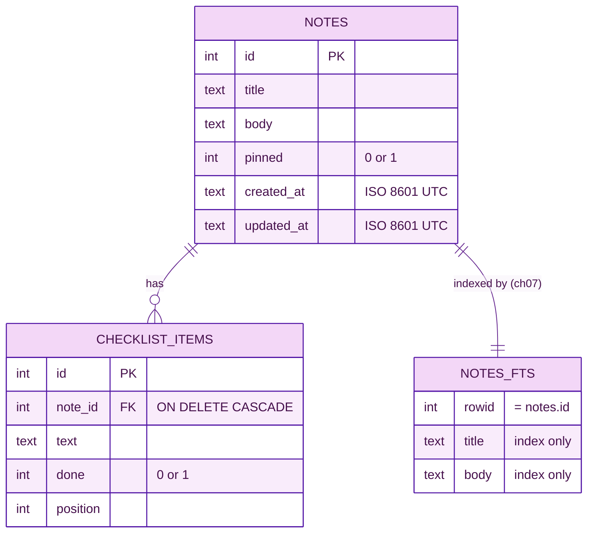

# 🗄️ Chapter 03 · SQLite storage

> **Section 2 · Data & logic** · ⏱️ 60 min · 🏷️ checkpoint tag: `ch03`

## 🎯 Goal

A storage layer that saves notes and checklist items in **one SQLite file**, upgrades its own
schema, and cannot be tricked by SQL injection — with tests that prove each of those claims.
There is still no web page: data first, everything else later.

## 🧠 Concepts

| Idea | Why it matters here |
|---|---|
| **SQLite** | A full SQL database in a single file. No server to install — perfect for an offline app. |
| **`sqlite3` module** | Ships with Python. Zero extra dependencies for storage. |
| **Parameters (`?`)** | Values travel *separately* from the SQL text, so a title like `'); DROP TABLE notes; --` is just text. |
| **Transactions** | `with conn:` commits if the block succeeds and rolls back if it raises — all or nothing. |
| **Foreign keys** | `checklist_items.note_id` must point at a real note; deleting a note deletes its items (`ON DELETE CASCADE`). |
| **Migrations** | `PRAGMA user_version` stores "schema version N" inside the file; the app upgrades old files on start-up. |
| **Per-user data folder** | The notes file lives where each OS expects app data — not wherever you happened to start the app. |

## 🗺️ Diagram — the tables



<sub>🖼️ Offline copy: [data-model.svg](../diagrams/data-model.svg) · source: [data-model.mmd](../diagrams/data-model.mmd)</sub>

## 🛠️ Build it

Three new files:

| File | Job |
|---|---|
| [`src/todonotes/models.py`](../../src/todonotes/models.py) | `Note` and `ChecklistItem` dataclasses — plain data, no SQL |
| [`src/todonotes/storage.py`](../../src/todonotes/storage.py) | `NoteRepository`: the only place in the app that writes SQL |
| [`src/todonotes/config.py`](../../src/todonotes/config.py) | Where the notes file lives on each operating system |

### 1 · The schema, as an append-only list of migrations

<!-- snippet: src/todonotes/storage.py -->
```python
MIGRATIONS: list[str] = [
    # v1 — notes and their checklist items
    """
    CREATE TABLE notes (
        id         INTEGER PRIMARY KEY AUTOINCREMENT,
        title      TEXT    NOT NULL DEFAULT '',
        body       TEXT    NOT NULL DEFAULT '',
        pinned     INTEGER NOT NULL DEFAULT 0 CHECK (pinned IN (0, 1)),
        created_at TEXT    NOT NULL,
        updated_at TEXT    NOT NULL
    );
```

SQLite has no separate boolean type, so `pinned` is an `INTEGER` with a `CHECK` that only
allows 0 or 1. Timestamps are ISO 8601 text in **UTC** (`2026-10-29T07:15:00+00:00`): they sort
correctly as text and convert to your local time only when shown.

### 2 · One short connection per operation

<!-- snippet: src/todonotes/storage.py -->
```python
def connect(self) -> sqlite3.Connection:
    conn = sqlite3.connect(self.db_path)
    conn.row_factory = sqlite3.Row  # rows behave like dicts: row["title"]
    conn.execute("PRAGMA foreign_keys = ON")  # off by default in SQLite!
    return conn

@contextmanager
def _transaction(self) -> Iterator[sqlite3.Connection]:
    with closing(self.connect()) as conn:
        with conn:  # commit on success, rollback on exception
            yield conn
```

**Why it is written this way**

- `with conn:` handles commit/rollback but does **not** close the connection — the Python docs
  say so explicitly — hence the extra `closing(...)`.
- The web server (Chapter 05) answers requests on several threads. A `sqlite3` connection may
  only be used by the thread that created it, so "open, use, close" per operation sidesteps the problem entirely.
- `PRAGMA foreign_keys = ON` must run on **every** connection; SQLite keeps it off by default for backwards compatibility.

### 3 · Migrations that run themselves

<!-- snippet: src/todonotes/storage.py -->
```python
version = conn.execute("PRAGMA user_version").fetchone()[0]
for number, script in enumerate(MIGRATIONS, start=1):
    if number > version:
        conn.executescript(script)
        # PRAGMA cannot take ? parameters; `number` is our own int.
        conn.execute(f"PRAGMA user_version = {int(number)}")
```

A brand-new file has `user_version = 0`, so every migration runs. A file from last month already
has `1`, so nothing runs. Ship a new feature that needs a column? **Append** migration 2 — never edit 1.

### 4 · Parameters, never string formatting

<!-- snippet: src/todonotes/storage.py -->
```python
cursor = conn.execute(
    "INSERT INTO notes (title, body, pinned, created_at, updated_at)"
    " VALUES (?, ?, ?, ?, ?)",
    (title, body, int(pinned), now, now),
)
```

And the test that proves it:

<!-- snippet: tests/unit/test_storage.py -->
```python
def test_values_are_parameters_not_sql(repo: NoteRepository) -> None:
    sneaky = "x'); DROP TABLE notes; --"
    note = repo.create_note(title=sneaky)
    assert repo.get_note(note.id).title == sneaky
    assert repo.count_notes() == 1
```

### 5 · Where the file lives

| OS | Folder |
|---|---|
| 🍎 macOS | `~/Library/Application Support/Forkable-ToDoNotes/` |
| 🪟 Windows | `%APPDATA%\Forkable-ToDoNotes\` |
| 🐧 Linux | `$XDG_DATA_HOME/Forkable-ToDoNotes/` (default `~/.local/share/…`) |

Set `TODONOTES_DB` to use another file — the tests and the e2e server rely on this kind of override.

## ▶️ Run it

<table>
<tr><th width="50%">🍎 macOS · Terminal (zsh)</th><th width="50%">🪟 Windows · PowerShell</th></tr>
<tr>
<td>

```bash
python -m pytest tests/unit/test_storage.py -v
```

</td>
<td>

```powershell
python -m pytest tests/unit/test_storage.py -v
```

</td>
</tr>
<tr><td colspan="2" align="center">✅ <b>Same command on both</b> — Git and pip behave identically here; only the shell differs.</td></tr>
</table>

Poke at a real database from the Python prompt (it is just a file):

<table>
<tr><th width="50%">🍎 macOS · Terminal (zsh)</th><th width="50%">🪟 Windows · PowerShell</th></tr>
<tr>
<td>

```bash
python - <<'EOF'
from todonotes.storage import NoteRepository
repo = NoteRepository("/tmp/try-notes.db")
repo.initialize()
note = repo.create_note(title="Hello", body="from Chapter 03")
repo.add_item(note.id, "learn SQLite")
print(repo.get_note(note.id))
EOF
```

</td>
<td>

```powershell
@"
from todonotes.storage import NoteRepository
repo = NoteRepository(r"$env:TEMP\try-notes.db")
repo.initialize()
note = repo.create_note(title="Hello", body="from Chapter 03")
repo.add_item(note.id, "learn SQLite")
print(repo.get_note(note.id))
"@ | python -
```

</td>
</tr>
</table>

## 🌿 Git checkpoint

<table>
<tr><th width="50%">🍎 macOS · Terminal (zsh)</th><th width="50%">🪟 Windows · PowerShell</th></tr>
<tr>
<td>

```bash
git switch -c chapter/03-sqlite-storage
git add src/todonotes/models.py src/todonotes/storage.py src/todonotes/config.py
git commit -m "feat(storage): SQLite repository with migrations and checklists"
git add tests
git commit -m "test(storage): cover CRUD, cascade, migrations and injection"
git switch main
git merge --no-ff chapter/03-sqlite-storage -m "Merge chapter 03: SQLite storage"
git tag -a ch03 -m "Chapter 03 checkpoint: SQLite storage"
```

</td>
<td>

```powershell
git switch -c chapter/03-sqlite-storage
git add src/todonotes/models.py src/todonotes/storage.py src/todonotes/config.py
git commit -m "feat(storage): SQLite repository with migrations and checklists"
git add tests
git commit -m "test(storage): cover CRUD, cascade, migrations and injection"
git switch main
git merge --no-ff chapter/03-sqlite-storage -m "Merge chapter 03: SQLite storage"
git tag -a ch03 -m "Chapter 03 checkpoint: SQLite storage"
```

</td>
</tr>
<tr><td colspan="2" align="center">✅ <b>Same command on both</b> — Git and pip behave identically here; only the shell differs.</td></tr>
</table>

## 📝 Notes

> [!WARNING]
> **Never** build SQL with f-strings and user input. The few f-strings in `storage.py` only
> insert *our own* column names, `?` placeholders or an `int` — and each one has a comment saying so.

> [!IMPORTANT]
> SQLite does **not** enforce foreign keys unless each connection runs `PRAGMA foreign_keys = ON`.
> Without it, deleting a note would leave orphaned checklist items behind.

> [!TIP]
> `sqlite3.Row` lets you write `row["title"]` instead of `row[1]`, so reordering columns never breaks the code.

## 🧪 Your turn

1. Add **migration 2** that adds a `color TEXT NOT NULL DEFAULT ''` column to `notes`.
2. Write a test: create a database, check `schema_version() == 2`, and check an *old* note gets `color == ''`.
3. Bonus: what happens if you *edit* migration 1 instead? (Hint: existing files already ran it.)

## 📚 Sources

- Python docs — [sqlite3](https://docs.python.org/3/library/sqlite3.html) (placeholders, `Row`, transactions and the context manager, threads)
- SQLite — [Foreign key support](https://sqlite.org/foreignkeys.html) · [PRAGMA user_version](https://sqlite.org/pragma.html#pragma_user_version)
- Python docs — [dataclasses](https://docs.python.org/3/library/dataclasses.html)
- freedesktop.org — [XDG Base Directory Specification](https://specifications.freedesktop.org/basedir-spec/latest/)
- pytest — [tmp_path](https://docs.pytest.org/en/stable/how-to/tmp_path.html) · [monkeypatch](https://docs.pytest.org/en/stable/how-to/monkeypatch.html)

---

[⬅️ Chapter 02](../section-1-orientation/chapter-02-architecture-and-data-flow.md) · [📚 Learning path](../README.md) · Next: Chapter 04 arrives at tag `ch04`.
