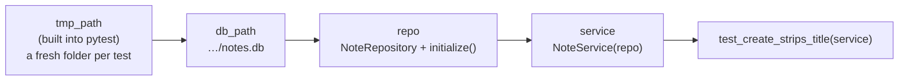

# 🧠 Chapter 04 · Service layer and unit tests

> **Section 2 · Data & logic** · ⏱️ 45 min · 🏷️ checkpoint tag: `ch04`

## 🎯 Goal

A `NoteService` that holds every **business rule** — trimming, length limits, defaults, "not
found" — in plain Python, plus a pytest setup (fixtures, parametrize, folder markers) that tests
those rules in milliseconds, without a browser or a server.

## 🧠 Concepts

| Idea | In one sentence |
|---|---|
| **Service layer** | The place for *rules*. Storage stores; the service decides what is allowed. |
| **Domain exceptions** | `ValidationError` ("your input breaks a rule") and `NotFoundError` ("no such note") — the web layer turns them into 400 and 404 later. |
| **Fixtures** | Functions that build what a test needs; a test asks for one by naming it as an argument. |
| **Fixture chains** | `service` needs `repo`, which needs `db_path`, which needs pytest's built-in `tmp_path`. |
| **Parametrize** | One test function, many input/expected pairs — each reported separately. |
| **Markers** | Labels like `unit` so you can run a slice: `pytest -m unit`. |

## 🗺️ Diagram — how a test gets its service



Every test gets its **own** empty database. No test can see another test's notes, so the order tests run in never matters.

## 🛠️ Build it

### 1 · Rules in one place — [`src/todonotes/service.py`](../../src/todonotes/service.py)

<!-- snippet: src/todonotes/service.py -->
```python
def _clean_text(value: str) -> str:
    """Normalise line endings (Windows sends \\r\\n) and strip trailing spaces."""
    return value.replace("\r\n", "\n").replace("\r", "\n").rstrip()

def create(self, title: str = "", body: str = "", pinned: bool = False) -> Note:
    title, body = title.strip(), _clean_text(body)
    _check_length("Title", title, MAX_TITLE)
    _check_length("Body", body, MAX_BODY)
    return self.repo.create_note(title=title, body=body, pinned=pinned)
```

**Why it is written this way**

- Browsers submit textareas with Windows-style `\r\n` line endings. Normalising to `\n` means
  the same note looks identical on every OS and in every export.
- The storage layer would happily save a 5 MB title; the *service* is where "too long" is decided.
- Error messages are written for humans because the web layer shows them as-is.

### 2 · A derived value instead of a stored one

An empty title is allowed. Instead of inventing one and saving it, `Note.display_title`
computes it each time: the title, else the first non-empty line of the body, else "Untitled note".
The database keeps exactly what you typed.

### 3 · Fixtures — [`tests/conftest.py`](../../tests/conftest.py)

<!-- snippet: tests/conftest.py -->
```python
@pytest.fixture
def db_path(tmp_path: Path) -> Path:
    """A fresh, empty notes file inside pytest's per-test temporary folder."""
    return tmp_path / "notes.db"

@pytest.fixture
def repo(db_path: Path) -> NoteRepository:
    repository = NoteRepository(db_path)
    repository.initialize()
    return repository
```

### 4 · Parametrize — four cases, one test

<!-- snippet: tests/unit/test_service.py -->
```python
@pytest.mark.parametrize(
    ("title", "body", "expected"),
    [
        ("Groceries", "milk", "Groceries"),
        ("", "\n\n  first real line \nsecond", "first real line"),
        ("", "", UNTITLED),
        ("", "y" * 80, "y" * 57 + "…"),
    ],
)
def test_display_title(title: str, body: str, expected: str) -> None:
```

### 5 · Markers applied by folder

Nobody remembers to type `@pytest.mark.unit` on every test, so a hook in `tests/conftest.py`
does it for them, based on the folder the test lives in:

<!-- snippet: tests/conftest.py -->
```python
def pytest_collection_modifyitems(items: list[pytest.Item]) -> None:
    for item in items:
        parts = Path(str(item.path)).parts
        if "unit" in parts:
            item.add_marker(pytest.mark.unit)
```

`pyproject.toml` registers the marker and turns on `--strict-markers`, so a typo like
`@pytest.mark.unti` is an error instead of a silently ignored label.

## ▶️ Run it

<table>
<tr><th width="50%">🍎 macOS · Terminal (zsh)</th><th width="50%">🪟 Windows · PowerShell</th></tr>
<tr>
<td>

```bash
python -m pytest -m unit -v                 # every fast test, verbose
python -m pytest -k display_title -v        # only tests whose name matches
python -m pytest --markers | head -5        # list registered markers
```

</td>
<td>

```powershell
python -m pytest -m unit -v                 # every fast test, verbose
python -m pytest -k display_title -v        # only tests whose name matches
python -m pytest --markers | Select-Object -First 5   # list registered markers
```

</td>
</tr>
<tr><td colspan="2" align="center">✅ <b>Same command on both</b> — Git and pip behave identically here; only the shell differs.</td></tr>
</table>

## 🌿 Git checkpoint

<table>
<tr><th width="50%">🍎 macOS · Terminal (zsh)</th><th width="50%">🪟 Windows · PowerShell</th></tr>
<tr>
<td>

```bash
git switch -c chapter/04-service-layer
git add src/todonotes/service.py
git commit -m "feat(service): validation, defaults and export rules"
git add tests
git commit -m "test(service): fixtures, parametrized rules and folder markers"
git switch main
git merge --no-ff chapter/04-service-layer -m "Merge chapter 04: service layer"
git tag -a ch04 -m "Chapter 04 checkpoint: service layer and unit tests"
```

</td>
<td>

```powershell
git switch -c chapter/04-service-layer
git add src/todonotes/service.py
git commit -m "feat(service): validation, defaults and export rules"
git add tests
git commit -m "test(service): fixtures, parametrized rules and folder markers"
git switch main
git merge --no-ff chapter/04-service-layer -m "Merge chapter 04: service layer"
git tag -a ch04 -m "Chapter 04 checkpoint: service layer and unit tests"
```

</td>
</tr>
<tr><td colspan="2" align="center">✅ <b>Same command on both</b> — Git and pip behave identically here; only the shell differs.</td></tr>
</table>

## 📝 Notes

> [!TIP]
> A good unit test name reads like a sentence about behaviour:
> `test_empty_item_is_rejected` tells you what broke before you open the file.

> [!NOTE]
> The export functions (`export_data`, `export_markdown`) live in the service because
> they are rules about *what a backup contains*, not about HTTP. Chapter 05 only adds download buttons.

## 🧪 Your turn

1. Add a rule: a note may have **at most 100 checklist items**. Raise `ValidationError` on the 101st.
2. Write the test first, watch it fail (red), then make it pass (green).
3. Run `python -m pytest -m unit -q` and check the total count went up by one.

## 📚 Sources

- pytest — [How to use fixtures](https://docs.pytest.org/en/stable/how-to/fixtures.html) · [parametrize](https://docs.pytest.org/en/stable/how-to/parametrize.html) · [markers](https://docs.pytest.org/en/stable/how-to/mark.html) · [the `pytest_collection_modifyitems` example](https://docs.pytest.org/en/stable/example/markers.html)
- pytest — [Configuration (`[tool.pytest]` in pyproject.toml)](https://docs.pytest.org/en/stable/reference/customize.html)
- Python docs — [dataclasses](https://docs.python.org/3/library/dataclasses.html) (`@property` on a dataclass works like on any class)

---

[⬅️ Chapter 03](chapter-03-sqlite-storage.md) · [📚 Learning path](../README.md) · **Next ➡️ [Chapter 05 · Flask routes & templates](../section-3-web-ui/chapter-05-flask-routes-and-templates.md)**
