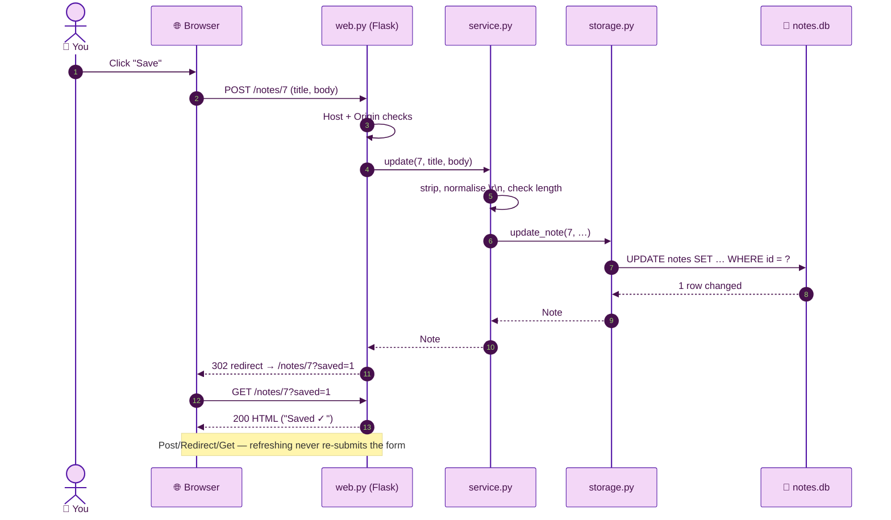

# 🧭 Chapter 05 · Flask routes and templates

> **Section 3 · Web UI** · ⏱️ 75 min · 🏷️ checkpoint tag: `ch05`

## 🎯 Goal

The app comes alive: `python -m todonotes` starts a local server, opens your browser, and
shows real pages — list, editor, checklist — built from Jinja templates. Plus a small JSON API,
downloadable exports, and three safety checks that matter for any app listening on your machine.

> [!NOTE]
> At this tag the pages are **unstyled HTML on purpose**. Semantic HTML that works with no CSS
> and no JavaScript is the foundation; Chapter 06 adds the purple design on top.

## 🧠 Concepts

| Idea | In one sentence |
|---|---|
| **WSGI** | The standard plug between a Python web app (Flask) and a server (Waitress). |
| **Application factory** | `create_app(db_path)` builds a fresh app — tests make one per test, with their own database. |
| **Routes** | `@app.get("/notes/<int:note_id>")` maps a URL to a function. `<int:…>` rejects non-numbers for free. |
| **Jinja templates** | `base.html` holds the page shell; `index.html` and `note.html` `` it and fill ``. |
| **Autoescaping** | Flask escapes every `{{ value }}` in `.html` templates, so a note containing `<script>` is shown as text. |
| **Post/Redirect/Get** | Every form POST answers with a redirect, so refresh never re-submits. |
| **Loopback only** | The server binds to `127.0.0.1`: other machines on your network cannot reach it. |

## 🗺️ Diagram — the Save request



<sub>🖼️ Offline copy: [request-flow.svg](../diagrams/request-flow.svg) · source: [request-flow.mmd](../diagrams/request-flow.mmd)</sub>

## 🛠️ Build it

### 1 · The routes — [`src/todonotes/web.py`](../../src/todonotes/web.py)

| Method + URL | What it does | Answers with |
|---|---|---|
| `GET /` | List notes (pinned first) | HTML |
| `GET /notes/new` · `POST /notes` | Empty editor · create | HTML · redirect |
| `GET /notes/<id>` · `POST /notes/<id>` | Editor · save | HTML · redirect |
| `POST /notes/<id>/pin` · `/delete` | Toggle pin · delete | redirect |
| `POST /notes/<id>/items` | Add a checklist item | redirect |
| `POST /items/<id>/toggle` · `/delete` | Tick/untick · remove an item | redirect |
| `GET /export.json` · `/export.md` | Download a backup | file |
| `GET/POST /api/notes`, `GET/PATCH/DELETE /api/notes/<id>` | JSON API | JSON |
| `POST /api/notes/<id>/items`, `PATCH/DELETE /api/items/<id>` | JSON API for checklists | JSON |
| `GET /api/health` | "Is this really our app?" probe | JSON |

Routes stay thin — read the request, call the service, render or redirect:

<!-- snippet: src/todonotes/web.py -->
```python
@app.post("/notes/<int:note_id>")
def update_note(note_id: int):
    service.update(
        note_id,
        title=request.form.get("title", ""),
        body=request.form.get("body", ""),
        pinned="pinned" in request.form,
    )
    return redirect(url_for("show_note", note_id=note_id, saved=1))
```

Errors are handled **once**, centrally: a `ValidationError` from the service becomes a 400,
a `NotFoundError` becomes a 404 — as an HTML page, or as JSON for `/api/…` URLs.

### 2 · Templates — inheritance and includes

```text
templates/
├── base.html         page shell: <head>, top bar, footer, 
├── index.html         → the grid of cards
├── _note_card.html   one card, d by index.html
├── note.html         the editor + checklist + "Delete this note…"
└── error.html        404 / 400 pages
```

The delete button hides inside a `<details>` element — a confirmation step that needs no
JavaScript and no pop-up dialog.

### 3 · Three safety checks for a local app

<!-- snippet: src/todonotes/web.py -->
```python
hostname = urlsplit(f"//{request.host}").hostname
if hostname not in LOCAL_HOSTNAMES:
    abort(400, "This app only answers on 127.0.0.1 or localhost.")
if request.method in UNSAFE_METHODS:
    fetch_site = request.headers.get("Sec-Fetch-Site")
    if fetch_site is not None and fetch_site not in {"same-origin", "none"}:
        abort(403, "Cross-site request refused.")
    origin = request.headers.get("Origin")
    if origin is not None and urlsplit(origin).netloc != request.host:
        abort(403, "Cross-site request refused.")
```

| Check | Stops | How |
|---|---|---|
| **Host** | DNS rebinding: a website re-points its own domain at `127.0.0.1` | That trick arrives with the attacker's domain in the `Host` header |
| **Sec-Fetch-Site** | Another website submitting a hidden form to your app (CSRF) | Modern browsers label the request `cross-site` or `same-site` |
| **Origin** | The same, in browsers without Fetch Metadata | Browsers add `Origin` to every POST/PATCH/DELETE |

> [!WARNING]
> These checks protect a **single-user app on your own machine**. They are not a login system.
> Never change the bind address to `0.0.0.0` to "share" the app on a network.

### 4 · The launcher — Waitress, not the Flask dev server

<!-- snippet: src/todonotes/__main__.py -->
```python
serve(app, host=LOOPBACK, port=port, threads=4)
```

Flask's own docs say not to use its development server outside development. **Waitress**
is a pure-Python WSGI server with no compiled parts that runs on Windows and Unix — a good fit
for an app we later package into one file. The launcher also picks a free port if `8765` is
busy and opens your default browser one second after start-up.

## ▶️ Run it

<table>
<tr><th width="50%">🍎 macOS · Terminal (zsh)</th><th width="50%">🪟 Windows · PowerShell</th></tr>
<tr>
<td>

```bash
python -m pip install -r requirements.txt   # adds Flask + Waitress
python -m todonotes                         # opens http://127.0.0.1:8765/
```

</td>
<td>

```powershell
python -m pip install -r requirements.txt   # adds Flask + Waitress
python -m todonotes                         # opens http://127.0.0.1:8765/
```

</td>
</tr>
<tr><td colspan="2" align="center">✅ <b>Same command on both</b> — Git and pip behave identically here; only the shell differs.</td></tr>
</table>

Try the API from a second terminal:

<table>
<tr><th width="50%">🍎 macOS · Terminal (zsh)</th><th width="50%">🪟 Windows · PowerShell</th></tr>
<tr>
<td>

```bash
curl -s http://127.0.0.1:8765/api/health
curl -s -X POST http://127.0.0.1:8765/api/notes \
  -H "Content-Type: application/json" \
  -d '{"title": "From curl", "items": ["one", "two"]}'
```

</td>
<td>

```powershell
Invoke-RestMethod http://127.0.0.1:8765/api/health
Invoke-RestMethod -Method Post http://127.0.0.1:8765/api/notes `
  -ContentType "application/json" `
  -Body '{"title": "From PowerShell", "items": ["one", "two"]}'
```

</td>
</tr>
</table>

Use a throw-away notes file while experimenting:

<table>
<tr><th width="50%">🍎 macOS · Terminal (zsh)</th><th width="50%">🪟 Windows · PowerShell</th></tr>
<tr>
<td>

```bash
TODONOTES_DB=/tmp/scratch.db python -m todonotes --port 9000
```

</td>
<td>

```powershell
$env:TODONOTES_DB = "$env:TEMP\scratch.db"; python -m todonotes --port 9000
```

</td>
</tr>
</table>

## 🧪 Tests — [`tests/unit/test_web.py`](../../tests/unit/test_web.py)

Flask's **test client** sends requests straight into the app object: no port, no browser, milliseconds per test.

<!-- snippet: tests/unit/test_web.py -->
```python
def test_note_text_is_escaped_not_executed(client: FlaskClient) -> None:
    make_note(client, title="<script>alert(1)</script>")
    page = client.get("/").get_data(as_text=True)
    assert "<script>alert(1)</script>" not in page
    assert "&lt;script&gt;alert(1)&lt;/script&gt;" in page
```

## 🌿 Git checkpoint

<table>
<tr><th width="50%">🍎 macOS · Terminal (zsh)</th><th width="50%">🪟 Windows · PowerShell</th></tr>
<tr>
<td>

```bash
git switch -c chapter/05-flask-routes
git add pyproject.toml requirements.txt
git commit -m "build: add Flask and Waitress runtime dependencies"
git add src
git commit -m "feat(web): routes, templates, JSON API and local-only safety checks"
git add tests
git commit -m "test(web): pages, API, escaping and cross-site refusal"
git switch main
git merge --no-ff chapter/05-flask-routes -m "Merge chapter 05: Flask routes and templates"
git tag -a ch05 -m "Chapter 05 checkpoint: Flask routes and templates"
```

</td>
<td>

```powershell
git switch -c chapter/05-flask-routes
git add pyproject.toml requirements.txt
git commit -m "build: add Flask and Waitress runtime dependencies"
git add src
git commit -m "feat(web): routes, templates, JSON API and local-only safety checks"
git add tests
git commit -m "test(web): pages, API, escaping and cross-site refusal"
git switch main
git merge --no-ff chapter/05-flask-routes -m "Merge chapter 05: Flask routes and templates"
git tag -a ch05 -m "Chapter 05 checkpoint: Flask routes and templates"
```

</td>
</tr>
<tr><td colspan="2" align="center">✅ <b>Same command on both</b> — Git and pip behave identically here; only the shell differs.</td></tr>
</table>

## 📝 Notes

> [!TIP]
> Stop the server with **Ctrl+C** in its terminal — on both macOS and Windows.

> [!IMPORTANT]
> Autoescaping only covers `{{ … }}` in templates. The moment you write `|safe` or `Markup(...)`,
> **you** are responsible for escaping. Chapter 07 shows the one place we do it, and how.

> [!NOTE]
> `/api/health` returns the app's name, not just "OK". A port can be taken by something else;
> checking the payload proves you reached *this* app.

## 🧪 Your turn

1. Add `GET /api/stats` returning `{"notes": N, "items": M, "done": D}`. Put the counting in the service.
2. Test it with the `client` fixture.
3. Try `curl -H "Origin: https://evil.example" -X POST http://127.0.0.1:8765/notes -d title=x` and read the 403.

## 📚 Sources

- Flask — [Templates](https://flask.palletsprojects.com/templating/) (autoescaping, `|safe`, `Markup`) · [Testing](https://flask.palletsprojects.com/en/stable/testing/) · [Development server](https://flask.palletsprojects.com/en/stable/server/) · [Application factories](https://flask.palletsprojects.com/en/stable/patterns/appfactories/)
- Jinja — [Template Designer Documentation](https://jinja.palletsprojects.com/en/stable/templates/) (`extends`, `block`, `include`, filters)
- Waitress — [Documentation](https://docs.pylonsproject.org/projects/waitress/en/stable/) · [Arguments](https://docs.pylonsproject.org/projects/waitress/en/stable/arguments.html) · Flask — [Deploying with Waitress](https://flask.palletsprojects.com/en/stable/deploying/waitress/)
- OWASP — [CSRF Prevention Cheat Sheet](https://cheatsheetseries.owasp.org/cheatsheets/Cross-Site_Request_Forgery_Prevention_Cheat_Sheet.html) (Fetch Metadata first, Origin as fallback)
- MDN — [Origin header](https://developer.mozilla.org/en-US/docs/Web/HTTP/Reference/Headers/Origin) · [Sec-Fetch-Site](https://developer.mozilla.org/en-US/docs/Web/HTTP/Reference/Headers/Sec-Fetch-Site)
- NCC Group — [Preventing DNS rebinding attacks](https://github.com/nccgroup/singularity/wiki/Preventing-DNS-Rebinding-Attacks) (allow-list the `Host` header for loopback services)
- Python docs — [webbrowser](https://docs.python.org/3/library/webbrowser.html)

---

[⬅️ Chapter 04](../section-2-data-and-logic/chapter-04-service-layer-and-unit-tests.md) · [📚 Learning path](../README.md) · Next: Chapter 06 arrives at tag `ch06`.
