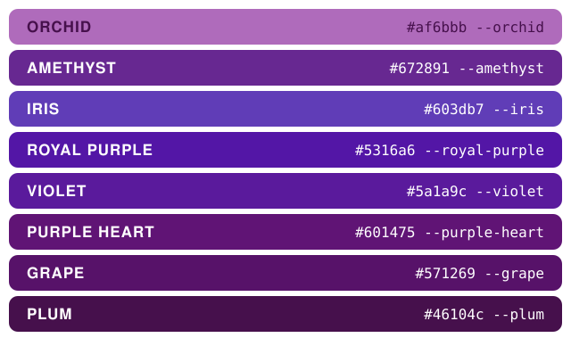
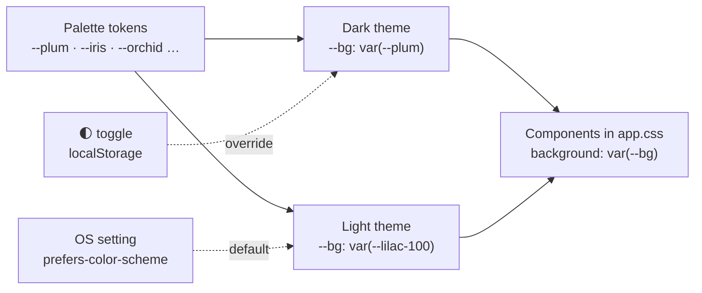

# 💜 Chapter 06 · Design system: CSS tokens and a little JavaScript

> **Section 3 · Web UI** · ⏱️ 60 min · 🏷️ checkpoint tag: `ch06`

## 🎯 Goal

Turn plain HTML into a polished, purple, light/dark app — **without a CSS framework, a CDN or a
web font**, so it still works offline. Prove the colours are readable with a test, and add four
small JavaScript enhancements that are optional by design.

## 🧠 Concepts

| Idea | In one sentence |
|---|---|
| **Design tokens** | Colours live in CSS custom properties (`--plum`), defined once and used everywhere. |
| **Two layers** | *Palette* tokens say what a colour **is**; *semantic* tokens (`--bg`, `--primary`) say what it **does**. |
| **Themes** | Light and dark re-point the semantic tokens; components never change. |
| **Contrast ratio** | WCAG AA asks for 4.5:1 for normal text. A script measures every text/background pair. |
| **Progressive enhancement** | The page works with plain HTML; JavaScript only makes it nicer. |

## 🎨 The palette

The eight colours were sampled from the reference image (median pixel of each satin band):

<p align="center"></p>

| Token | Hex | White text on it | Used for |
|---|---|---|---|
| `--orchid` | `#af6bbb` | 3.72 ❌ (accents only) | card border when pinned, palette strip |
| `--amethyst` | `#672891` | 9.17 ✅ | button hover (light theme) |
| `--iris` | `#603db7` | 7.37 ✅ | primary button (dark), focus ring (light) |
| `--royal-purple` | `#5316a6` | 10.33 ✅ | primary button + links (light) |
| `--violet` | `#5a1a9c` | 10.18 ✅ | palette strip |
| `--purple-heart` | `#601475` | 11.33 ✅ | raised surfaces (dark) |
| `--grape` | `#571269` | 12.38 ✅ | cards (dark) |
| `--plum` | `#46104c` | 14.59 ✅ | page background (dark), text (light) |

A light theme needs pale tints that are **not** in the image. They are clearly marked
*derived* in [`theme.css`](../../src/todonotes/static/theme.css) — mixed from the same hues.

## 🗺️ Diagram — tokens flow one way



## 🛠️ Build it

### 1 · Tokens — [`src/todonotes/static/theme.css`](../../src/todonotes/static/theme.css)

<!-- snippet: src/todonotes/static/theme.css -->
```css
:root,
:root[data-theme="dark"] {
  color-scheme: dark;
  --bg:            var(--plum);
  --surface:       var(--grape);
  --primary:       var(--iris);
  --link:          var(--orchid-200);
}

:root[data-theme="light"] {
  color-scheme: light;
  --bg:            var(--lilac-100);
  --text:          var(--plum);
  --primary:       var(--royal-purple);
}
```

[`app.css`](../../src/todonotes/static/app.css) only ever says `var(--bg)` or `var(--primary)` —
never a hex code. **To re-theme the whole app, edit eight lines.**

### 2 · Contrast, measured — [`scripts/check_contrast.py`](../../scripts/check_contrast.py)

WCAG defines *relative luminance* `L = 0.2126·R + 0.7152·G + 0.0722·B` (on linearised sRGB)
and *contrast ratio* `(L1 + 0.05) / (L2 + 0.05)`. The script resolves every `var(--…)` for each
theme and checks 12 text/background pairs × 3 themes:

<table>
<tr><th width="50%">🍎 macOS · Terminal (zsh)</th><th width="50%">🪟 Windows · PowerShell</th></tr>
<tr>
<td>

```bash
python scripts/check_contrast.py
```

</td>
<td>

```powershell
python scripts/check_contrast.py
```

</td>
</tr>
<tr><td colspan="2" align="center">✅ <b>Same command on both</b> — Git and pip behave identically here; only the shell differs.</td></tr>
</table>

```text
dark       --text #fbf5fd       --bg #46104c        13.61 ✅
dark       --on-primary #ffffff --primary #603db7    7.37 ✅
light      --link #5316a6       --surface #ffffff   10.33 ✅
...
36/36 pairs meet WCAG AA (4.5:1).
```

[`tests/unit/test_contrast.py`](../../tests/unit/test_contrast.py) runs the same check in pytest,
so a fork that picks an unreadable colour **fails CI**.

### 3 · JavaScript that is optional — [`src/todonotes/static/app.js`](../../src/todonotes/static/app.js)

| Enhancement | Without JS | With JS |
|---|---|---|
| 🌓 Theme toggle | Follows your OS setting | Remembers your choice (`localStorage`) |
| 💾 Autosave | Press **Save** | Saves 0.6 s after you stop typing (`PATCH /api/notes/<id>`) |
| ☑️ Checklist tick | Form post + page reload | Instant tick via `PATCH /api/items/<id>` |
| ⌨️ Shortcuts | — | `/` focuses search · `Ctrl/⌘+S` saves |

<!-- snippet: src/todonotes/static/app.js -->
```js
if (form && noteId) {
  form.addEventListener("input", function () {
    setStatus("Editing…");
    clearTimeout(timer);
    timer = setTimeout(autosave, 600);
  });
}
```

A *debounce*: every keystroke restarts a 600 ms timer, so a sentence typed quickly causes **one** save, not forty.

### 4 · Accessibility details that cost nothing

- A **skip link** ("Skip to content") for keyboard users.
- Every input has a real `<label>`; icon-only buttons have `aria-label`.
- Checklist ticks are buttons with `role="checkbox"` and `aria-checked`, so screen readers
  (and Playwright's `get_by_role("checkbox")` in Chapter 08) understand them.
- `:focus-visible` outlines in the palette colour; `prefers-reduced-motion` turns transitions off.

## ▶️ Run it

<table>
<tr><th width="50%">🍎 macOS · Terminal (zsh)</th><th width="50%">🪟 Windows · PowerShell</th></tr>
<tr>
<td>

```bash
python -m todonotes
# then: click 🌓, type in a note and watch "Saved ✓", press / on the list page
```

</td>
<td>

```powershell
python -m todonotes
# then: click 🌓, type in a note and watch "Saved ✓", press / on the list page
```

</td>
</tr>
<tr><td colspan="2" align="center">✅ <b>Same command on both</b> — Git and pip behave identically here; only the shell differs.</td></tr>
</table>

## 🌿 Git checkpoint

<table>
<tr><th width="50%">🍎 macOS · Terminal (zsh)</th><th width="50%">🪟 Windows · PowerShell</th></tr>
<tr>
<td>

```bash
git switch -c chapter/06-design-system
git add src/todonotes/static src/todonotes/templates
git commit -m "feat(ui): purple design tokens, light/dark themes and progressive JS"
git add scripts/check_contrast.py tests
git commit -m "test(ui): enforce WCAG AA contrast for every theme"
git switch main
git merge --no-ff chapter/06-design-system -m "Merge chapter 06: design system"
git tag -a ch06 -m "Chapter 06 checkpoint: design system"
```

</td>
<td>

```powershell
git switch -c chapter/06-design-system
git add src/todonotes/static src/todonotes/templates
git commit -m "feat(ui): purple design tokens, light/dark themes and progressive JS"
git add scripts/check_contrast.py tests
git commit -m "test(ui): enforce WCAG AA contrast for every theme"
git switch main
git merge --no-ff chapter/06-design-system -m "Merge chapter 06: design system"
git tag -a ch06 -m "Chapter 06 checkpoint: design system"
```

</td>
</tr>
<tr><td colspan="2" align="center">✅ <b>Same command on both</b> — Git and pip behave identically here; only the shell differs.</td></tr>
</table>

## 📝 Notes

> [!WARNING]
> **Orchid** (`#af6bbb`) is lovely but only 3.72:1 against white — below AA for normal text.
> It is used for borders and decoration, never for words.

> [!TIP]
> A tiny script, [`theme-init.js`](../../src/todonotes/static/theme-init.js), is loaded in the
> `<head>` and applies the saved theme **before** the page paints, so you never see a flash of
> the wrong theme. It is a separate file (not an inline `<script>`) because the app's
> Content-Security-Policy allows scripts only from the app itself.

> [!NOTE]
> `localStorage` can throw when storage is blocked (some privacy settings). Every access is
> wrapped in `try … catch`, and the app simply follows the OS setting instead.

## 🧪 Your turn

1. Fork the palette: replace the eight `--orchid … --plum` values with colours you like.
2. Run `python scripts/check_contrast.py`. Fix any ❌ by adjusting a *derived* tint.
3. Run the app with JavaScript disabled in your browser's settings. What still works?

## 📚 Sources

- WCAG 2.2 — [Understanding Contrast (Minimum)](https://www.w3.org/WAI/WCAG22/Understanding/contrast-minimum.html) · [Technique G18 (the formula)](https://www.w3.org/WAI/WCAG22/Techniques/general/G18)
- MDN — [Using CSS custom properties](https://developer.mozilla.org/en-US/docs/Web/CSS/Guides/Cascading_variables/Using_custom_properties) · [prefers-color-scheme](https://developer.mozilla.org/en-US/docs/Web/CSS/Reference/At-rules/@media/prefers-color-scheme) · [color-mix()](https://developer.mozilla.org/en-US/docs/Web/CSS/Reference/Values/color_value/color-mix)
- MDN — [localStorage](https://developer.mozilla.org/en-US/docs/Web/API/Window/localStorage) · [ARIA checkbox role](https://developer.mozilla.org/en-US/docs/Web/Accessibility/ARIA/Reference/Roles/checkbox_role)

---

[⬅️ Chapter 05](chapter-05-flask-routes-and-templates.md) · [📚 Learning path](../README.md) · **Next ➡️ [Chapter 07 · Full-text search](chapter-07-full-text-search-fts5.md)**
