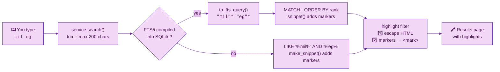

# 🔎 Chapter 07 · Full-text search with SQLite FTS5

> **Section 3 · Web UI** · ⏱️ 60 min · 🏷️ checkpoint tag: `ch07`

## 🎯 Goal

Type `mil` and instantly see every note containing *milk* or *milkshake* — ranked by relevance,
with the matching words highlighted — using SQLite's built-in **FTS5** engine. No search server,
no extra package. And when a Python build lacks FTS5, search still works (more simply).

## 🧠 Concepts

| Idea | In one sentence |
|---|---|
| **FTS5** | A SQLite *virtual table* that keeps an inverted index: word → which rows contain it. |
| **External content** | The index stores only the index; the text stays in `notes`. Triggers keep them in sync. |
| **Prefix query** | `"mil"*` matches any word *starting* with `mil`. |
| **`rank` / BM25** | Relevance score. FTS5 makes better matches *smaller*, so plain `ORDER BY rank` is best-first. |
| **`snippet()`** | Returns a short window of the matching text with markers around each hit. |
| **Quoting user input** | Every typed word becomes `"word"*`, so characters like `-`, `(` or `NEAR` are text, never operators. |
| **Escape, *then* mark** | HTML-escape the snippet first, then turn our markers into `<mark>` — the one place we bypass autoescaping safely. |

## 🗺️ Diagram — from keystrokes to highlights



<sub>🖼️ Offline copy: [search-flow.svg](../diagrams/search-flow.svg) · source: [search-flow.mmd](../diagrams/search-flow.mmd)</sub>

## 🛠️ Build it

### 1 · The index and its three triggers — [`storage.py`](../../src/todonotes/storage.py)

<!-- snippet: src/todonotes/storage.py -->
```python
FTS_TABLE_SQL = """
CREATE VIRTUAL TABLE IF NOT EXISTS notes_fts USING fts5(
    title, body, content='notes', content_rowid='id', prefix='2 3'
);
"""
CREATE TRIGGER IF NOT EXISTS notes_ai AFTER INSERT ON notes BEGIN
    INSERT INTO notes_fts(rowid, title, body) VALUES (new.id, new.title, new.body);
END;
```

This is the trigger pattern from the official FTS5 documentation: *insert* adds to the index,
*delete* sends a special `'delete'` command, and *update* does both. `prefix='2 3'` builds
extra indexes that make 2- and 3-letter prefix searches fast.

### 2 · Safe queries from anything a person types

<!-- snippet: src/todonotes/storage.py -->
```python
terms = [word.replace('"', "") for word in text.split()]
return " ".join(f'"{term}"*' for term in terms if term)
```

| You type | FTS5 query | Meaning |
|---|---|---|
| `mil` | `"mil"*` | words starting with *mil* |
| `mil eg` | `"mil"* "eg"*` | both prefixes must appear |
| `a-b OR (c)` | `"a-b"* "OR"* "(c)"*` | treated as text — no syntax error possible |

### 3 · Rank and snippet in one query

<!-- snippet: src/todonotes/storage.py -->
```python
"SELECT notes.*, snippet(notes_fts, -1, ?, ?, '…', 12) AS snip"
" FROM notes_fts JOIN notes ON notes.id = notes_fts.rowid"
" WHERE notes_fts MATCH ? ORDER BY rank LIMIT ?",
```

`snippet(table, -1, start, end, ellipsis, 12)`: column `-1` lets FTS5 pick the best column,
and the window is at most 12 tokens. The start/end markers are two control characters
(`\x02`, `\x03`) that nobody can type into a note.

### 4 · Escape first, then highlight — [`web.py`](../../src/todonotes/web.py)

<!-- snippet: src/todonotes/web.py -->
```python
def highlight(snippet: str) -> Markup:
    safe = str(escape(snippet))
    return Markup(safe.replace(MARK_START, "<mark>").replace(MARK_END, "</mark>"))
```

Reverse those two steps and a note containing `` would run in your
browser. The order is tested in [`test_search.py`](../../tests/unit/test_search.py) *and*
in a real browser in Chapter 09.

### 5 · No FTS5? Graceful fallback

`fts5_available()` probes the SQLite library once at start-up. Without FTS5 the repository
uses `LIKE '%word%'` (with `%` and `_` escaped) and a small Python `make_snippet()`. If a notes
file moves from a machine *with* FTS5 to one *without* it, the triggers are dropped (otherwise
every save would fail), and they are rebuilt — with a full `'rebuild'` of the index — when FTS5 is back.
The footer shows which engine is active: **Search: FTS5** or **Search: LIKE**.

## ▶️ Run it

Check your Python's SQLite build:

<table>
<tr><th width="50%">🍎 macOS · Terminal (zsh)</th><th width="50%">🪟 Windows · PowerShell</th></tr>
<tr>
<td>

```bash
python -c "from todonotes.storage import fts5_available; print('FTS5:', fts5_available())"
```

</td>
<td>

```powershell
python -c "from todonotes.storage import fts5_available; print('FTS5:', fts5_available())"
```

</td>
</tr>
</table>

Search through the API while the app is running:

<table>
<tr><th width="50%">🍎 macOS · Terminal (zsh)</th><th width="50%">🪟 Windows · PowerShell</th></tr>
<tr>
<td>

```bash
curl -s "http://127.0.0.1:8765/api/notes?q=mil"
```

</td>
<td>

```powershell
Invoke-RestMethod "http://127.0.0.1:8765/api/notes?q=mil"
```

</td>
</tr>
</table>

<table>
<tr><th width="50%">🍎 macOS · Terminal (zsh)</th><th width="50%">🪟 Windows · PowerShell</th></tr>
<tr>
<td>

```bash
python -m pytest tests/unit/test_search.py -v
```

</td>
<td>

```powershell
python -m pytest tests/unit/test_search.py -v
```

</td>
</tr>
<tr><td colspan="2" align="center">✅ <b>Same command on both</b> — Git and pip behave identically here; only the shell differs.</td></tr>
</table>

## 🌿 Git checkpoint

<table>
<tr><th width="50%">🍎 macOS · Terminal (zsh)</th><th width="50%">🪟 Windows · PowerShell</th></tr>
<tr>
<td>

```bash
git switch -c chapter/07-fts5-search
git add src
git commit -m "feat(search): FTS5 index with prefix queries, ranking and safe highlights"
git add tests
git commit -m "test(search): operators, fallback, rebuild and escaping"
git switch main
git merge --no-ff chapter/07-fts5-search -m "Merge chapter 07: full-text search"
git tag -a ch07 -m "Chapter 07 checkpoint: full-text search"
```

</td>
<td>

```powershell
git switch -c chapter/07-fts5-search
git add src
git commit -m "feat(search): FTS5 index with prefix queries, ranking and safe highlights"
git add tests
git commit -m "test(search): operators, fallback, rebuild and escaping"
git switch main
git merge --no-ff chapter/07-fts5-search -m "Merge chapter 07: full-text search"
git tag -a ch07 -m "Chapter 07 checkpoint: full-text search"
```

</td>
</tr>
<tr><td colspan="2" align="center">✅ <b>Same command on both</b> — Git and pip behave identically here; only the shell differs.</td></tr>
</table>

## 📝 Notes

> [!IMPORTANT]
> Triggers only index rows changed **after** they exist. That is why creating the index runs
> `INSERT INTO notes_fts(notes_fts) VALUES ('rebuild')` once — otherwise old notes would be invisible to search.

> [!TIP]
> In FTS5, a `*` must be **outside** the double quotes: `"mil"*` is a prefix query, `"mil*"` is not.

> [!NOTE]
> SQLite's `LIKE` ignores case only for ASCII letters. FTS5's default tokenizer folds case for
> Unicode letters too — one more reason FTS5 is the preferred engine.

## 🧪 Your turn

1. Make checklist items searchable: add an `items` column to the FTS table, fill it with the
   note's item texts, and keep it in sync (hint: the triggers live on `notes`; items need their own).
2. Add a test: a note whose only match is a checklist item is found by search.

## 📚 Sources

- SQLite — [FTS5](https://sqlite.org/fts5.html) (external content tables, triggers, `rebuild`, `snippet()`, `bm25()`/`rank`, prefix queries)
- SQLite — [LIKE and ESCAPE](https://sqlite.org/lang_expr.html#like)
- MarkupSafe — [Documentation](https://markupsafe.palletsprojects.com/en/stable/) (`escape`, `Markup`)
- Flask — [Templates: controlling autoescaping](https://flask.palletsprojects.com/templating/)

---

[⬅️ Chapter 06](chapter-06-design-system-css-and-js.md) · [📚 Learning path](../README.md) · **Next ➡️ [Chapter 08 · Playwright foundations](../section-4-automation/chapter-08-playwright-foundations.md)**
