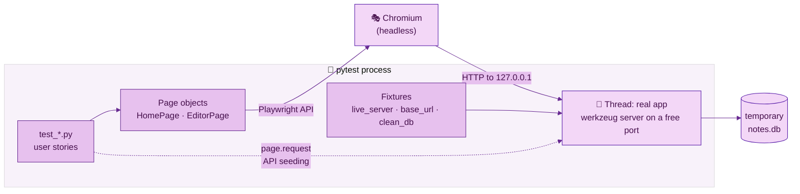

# 🎭 Chapter 08 · Playwright foundations

> **Section 4 · Automation** · ⏱️ 60 min · 🏷️ checkpoint tag: `ch08`

## 🎯 Goal

Drive a **real browser** against a **real running copy** of the app — from pytest, on macOS,
Windows and Linux. You will set up the live-server fixture, write page objects, and pass your first
two end-to-end (e2e) tests: *the app opens* and *I can create a note*.

## 🧠 Concepts

| Idea | In one sentence |
|---|---|
| **Playwright** | Microsoft's browser automation library; `pytest-playwright` gives pytest the `page`, `context` and `browser` fixtures. |
| **Live server** | The app runs in a background thread on a free port, against a temporary database. |
| **`base_url`** | Tell pytest-playwright where the app is, and tests can write `page.goto("/")`. |
| **Locators** | *How to find* an element — preferably the way a user would: by role and accessible name. |
| **Web-first assertions** | `expect(locator).to_have_text(...)` retries until true (default 5 s), so no `sleep()`. |
| **Page objects** | One class per screen holds its locators and actions; tests read like user stories. |

## 🗺️ Diagram — who runs what



<sub>🖼️ Offline copy: [e2e-architecture.svg](../diagrams/e2e-architecture.svg) · source: [e2e-architecture.mmd](../diagrams/e2e-architecture.mmd)</sub>

## 🛠️ Build it

### Step 1 — Install Playwright and a browser

<table>
<tr><th width="50%">🍎 macOS · Terminal (zsh)</th><th width="50%">🪟 Windows · PowerShell</th></tr>
<tr>
<td>

```bash
python -m pip install -r requirements-dev.txt     # adds playwright + pytest-playwright
python -m playwright install chromium             # downloads the browser (~once)
```

</td>
<td>

```powershell
python -m pip install -r requirements-dev.txt     # adds playwright + pytest-playwright
python -m playwright install chromium             # downloads the browser (~once)
```

</td>
</tr>
<tr><td colspan="2" align="center">✅ <b>Same command on both</b> — Git and pip behave identically here; only the shell differs.</td></tr>
</table>

Browsers are cached per user and shared by all projects:

| OS | Default cache |
|---|---|
| 🍎 macOS | `~/Library/Caches/ms-playwright` |
| 🪟 Windows | `%USERPROFILE%\AppData\Local\ms-playwright` |
| 🐧 Linux | `~/.cache/ms-playwright` |

> [!NOTE]
> This download is the **only** step in the course that needs internet after `pip install`.
> The app itself never does — Chapter 09 proves it.

### Step 2 — A real server for the browser — [`tests/e2e/conftest.py`](../../tests/e2e/conftest.py)

<!-- snippet: tests/e2e/conftest.py -->
```python
@pytest.fixture(scope="session")
def live_server(tmp_path_factory: pytest.TempPathFactory) -> Iterator[LiveServer]:
    db_path = tmp_path_factory.mktemp("e2e") / "notes.db"
    app = create_app(db_path)
    server = make_server("127.0.0.1", 0, app, threaded=True)
    thread = threading.Thread(target=server.serve_forever, daemon=True)
    thread.start()
    yield LiveServer(url=f"http://127.0.0.1:{server.server_port}", db_path=db_path)
    server.shutdown()

@pytest.fixture(scope="session")
def base_url(live_server: LiveServer) -> str:
    """Overrides pytest-playwright's own `base_url` fixture with the live server's URL."""
    return live_server.url
```

- **Port 0** asks the OS for any free port, so tests never clash with an app you already have open.
- **`base_url`**: pytest-playwright passes this fixture's value to every browser context, so
  `page.goto("/")` and `page.request.post("/api/notes")` resolve against the live server. (Since
  pytest-playwright 0.10 the plugin defines `base_url` itself; the separate `pytest-base-url`
  package became an optional extra — confirmed in the installed plugin's source.)
- **Session scope** starts the server once for the whole run; an **autouse** `clean_db` fixture
  empties the database before *each* test, so tests stay independent.
- `make_server` comes from Werkzeug (Flask's toolkit). Its docstring says it is what `run_simple`
  uses internally and "can be used separately to have access to the server object, such as to run
  it in a separate thread" — exactly what a fixture needs. The server is a standard-library
  `HTTPServer` subclass, so `serve_forever()` and `shutdown()` come from Python's `socketserver`.

### Step 3 — Page objects — [`tests/e2e/pages/`](../../tests/e2e/pages/)

<!-- snippet: tests/e2e/pages/editor_page.py -->
```python
class EditorPage(BasePage):
    def __init__(self, page) -> None:
        super().__init__(page)
        self.title = page.get_by_label("Title")
        self.body = page.get_by_label("Note", exact=True)
        self.status = page.get_by_role("status")

    def item(self, text: str) -> Locator:
        """A checklist item's checkbox, found by its accessible name."""
        return self.page.get_by_role("checkbox", name=text, exact=True)
```

Locators use **what a user perceives** — a label, a role, a name — not CSS classes. Rename a class
in `app.css` and these tests do not care; break the label and they rightly fail.

### Step 4 — The first two tests — [`tests/e2e/test_smoke.py`](../../tests/e2e/test_smoke.py)

<!-- snippet: tests/e2e/test_smoke.py -->
```python
def test_create_a_note(page: Page) -> None:
    home = HomePage(page).open()
    home.new_note_link.click()

    editor = EditorPage(page)
    editor.write("Groceries", "milk\neggs")
    editor.save()

    expect(page).to_have_url(re.compile(r"/notes/\d+"))
    expect(editor.status).to_have_text("Saved ✓")
```

## ▶️ Run it

<table>
<tr><th width="50%">🍎 macOS · Terminal (zsh)</th><th width="50%">🪟 Windows · PowerShell</th></tr>
<tr>
<td>

```bash
python -m pytest -m e2e                      # headless (no window)
python -m pytest -m e2e --headed --slowmo 300   # watch it, 300 ms per action
python -m pytest -m smoke -v                 # just the smoke tests
```

</td>
<td>

```powershell
python -m pytest -m e2e                      # headless (no window)
python -m pytest -m e2e --headed --slowmo 300   # watch it, 300 ms per action
python -m pytest -m smoke -v                 # just the smoke tests
```

</td>
</tr>
<tr><td colspan="2" align="center">✅ <b>Same command on both</b> — Git and pip behave identically here; only the shell differs.</td></tr>
</table>

Debug a test step by step with the **Playwright Inspector**:

<table>
<tr><th width="50%">🍎 macOS · Terminal (zsh)</th><th width="50%">🪟 Windows · PowerShell</th></tr>
<tr>
<td>

```bash
PWDEBUG=1 python -m pytest tests/e2e/test_smoke.py -s
```

</td>
<td>

```powershell
$env:PWDEBUG=1; python -m pytest tests/e2e/test_smoke.py -s
Remove-Item Env:PWDEBUG     # switch it off again
```

</td>
</tr>
</table>

Let Playwright **write a test for you** while you click around the running app:

<table>
<tr><th width="50%">🍎 macOS · Terminal (zsh)</th><th width="50%">🪟 Windows · PowerShell</th></tr>
<tr>
<td>

```bash
python -m todonotes --no-browser &              # (or run it in another terminal)
python -m playwright codegen http://127.0.0.1:8765/
```

</td>
<td>

```powershell
Start-Process python -ArgumentList "-m todonotes --no-browser"
python -m playwright codegen http://127.0.0.1:8765/
```

</td>
</tr>
<tr><td colspan="2" align="center">✅ <b>Same command on both</b> — Git and pip behave identically here; only the shell differs.</td></tr>
</table>

## 🌿 Git checkpoint

<table>
<tr><th width="50%">🍎 macOS · Terminal (zsh)</th><th width="50%">🪟 Windows · PowerShell</th></tr>
<tr>
<td>

```bash
git switch -c chapter/08-playwright-foundations
git add requirements-dev.txt pyproject.toml
git commit -m "build: add Playwright and pytest-playwright for browser tests"
git add tests
git commit -m "test(e2e): live server fixture, page objects and smoke tests"
git switch main
git merge --no-ff chapter/08-playwright-foundations -m "Merge chapter 08: Playwright foundations"
git tag -a ch08 -m "Chapter 08 checkpoint: Playwright foundations"
```

</td>
<td>

```powershell
git switch -c chapter/08-playwright-foundations
git add requirements-dev.txt pyproject.toml
git commit -m "build: add Playwright and pytest-playwright for browser tests"
git add tests
git commit -m "test(e2e): live server fixture, page objects and smoke tests"
git switch main
git merge --no-ff chapter/08-playwright-foundations -m "Merge chapter 08: Playwright foundations"
git tag -a ch08 -m "Chapter 08 checkpoint: Playwright foundations"
```

</td>
</tr>
<tr><td colspan="2" align="center">✅ <b>Same command on both</b> — Git and pip behave identically here; only the shell differs.</td></tr>
</table>

## 📝 Notes

> [!WARNING]
> Never `time.sleep()` in a browser test. Use `expect(...)` (retries until true) or
> `page.expect_response(...)` (waits for a specific network call). Sleeps are slow *and* flaky.

> [!TIP]
> On Linux CI machines use `python -m playwright install --with-deps chromium`: `--with-deps`
> also installs the system libraries the browser needs.

> [!NOTE]
> Why `get_by_role("checkbox")` works on our checklist: Chapter 06 gave each tick button
> `role="checkbox"` and `aria-checked`. Accessible HTML and testable HTML are the same thing.

## 🧪 Your turn

1. Write `test_pinned_badge_is_visible`: create a pinned note via the editor's checkbox and assert the 📌 badge shows on the home page.
2. Run it with `--headed --slowmo 500` and watch.
3. Record a flow with `codegen`, then rewrite the generated code using the page objects.

## 📚 Sources

- Playwright for Python — [Installation](https://playwright.dev/python/docs/intro) · [Pytest plugin reference](https://playwright.dev/python/docs/test-runners) (`--headed`, `--slowmo`, `--base-url`, fixtures)
- Playwright — [Locators](https://playwright.dev/python/docs/locators) · [Assertions](https://playwright.dev/python/docs/test-assertions) · [Page Object Models](https://playwright.dev/python/docs/pom)
- Playwright — [Browsers](https://playwright.dev/python/docs/browsers) (`install`, `--with-deps`, cache folders) · [Debugging](https://playwright.dev/python/docs/debug) (`PWDEBUG`) · [Codegen](https://playwright.dev/python/docs/codegen)
- pytest — [Fixtures (scope, autouse, yield)](https://docs.pytest.org/en/stable/how-to/fixtures.html) · Werkzeug — [Serving (port 0)](https://werkzeug.palletsprojects.com/en/stable/serving/)

---

[⬅️ Chapter 07](../section-3-web-ui/chapter-07-full-text-search-fts5.md) · [📚 Learning path](../README.md) · **Next ➡️ [Chapter 09 · Playwright showcase](chapter-09-playwright-showcase.md)**
