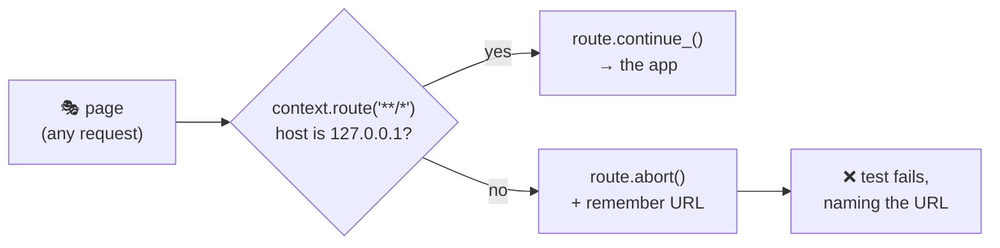
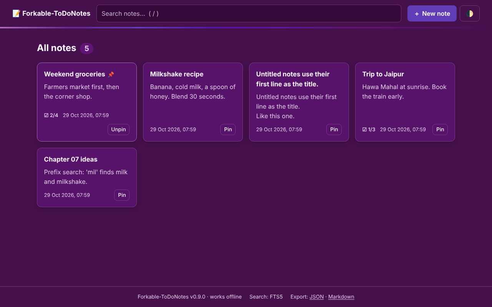
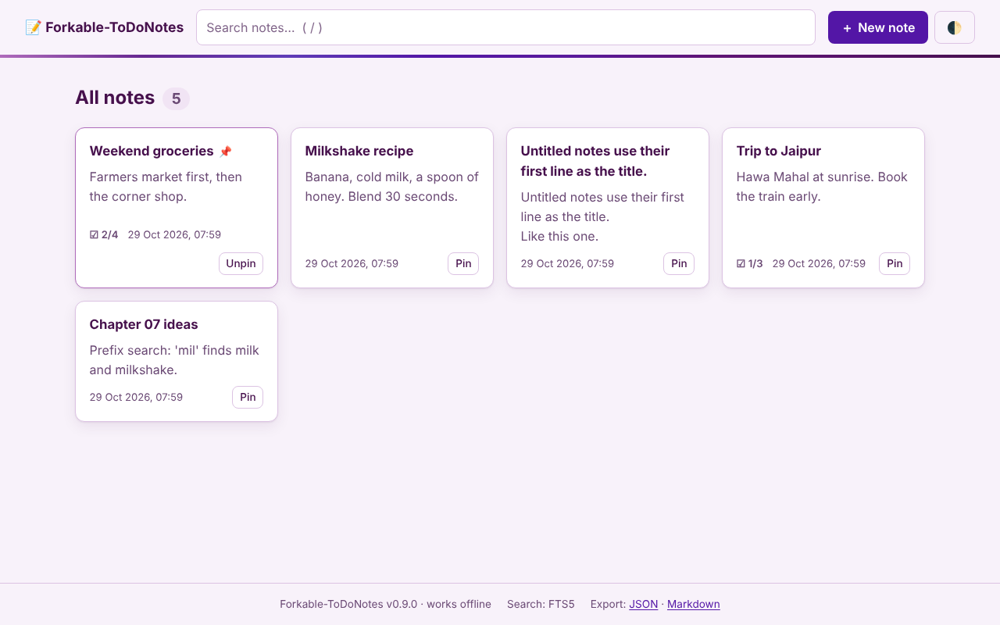
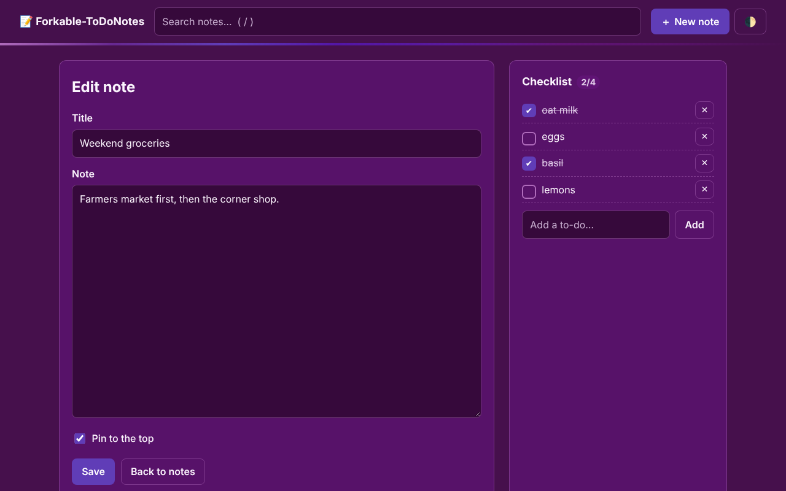
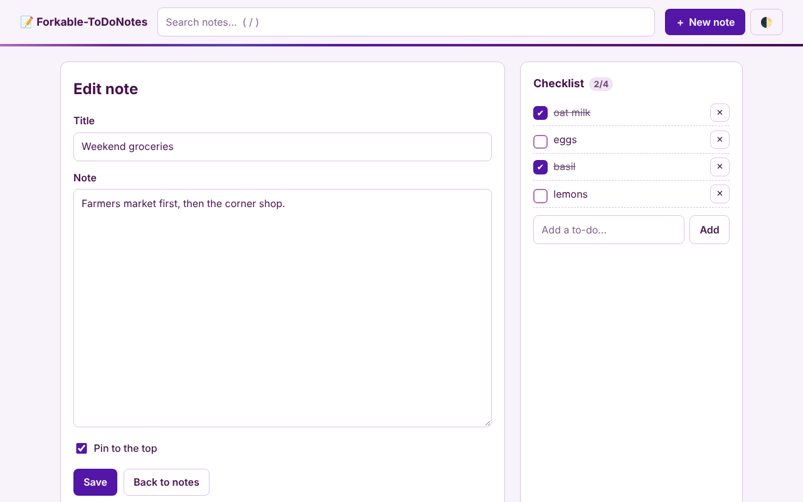
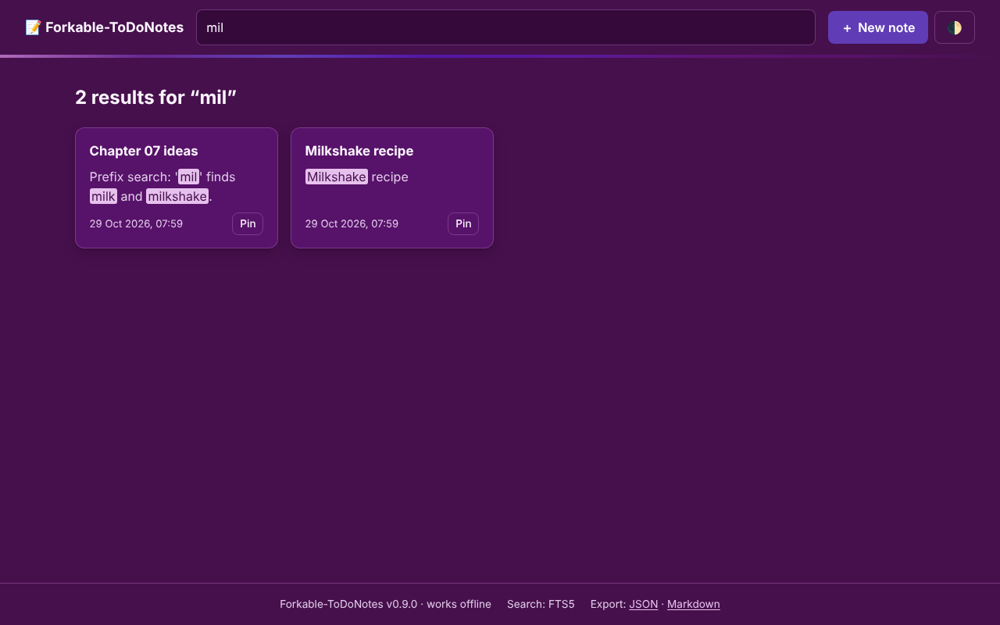
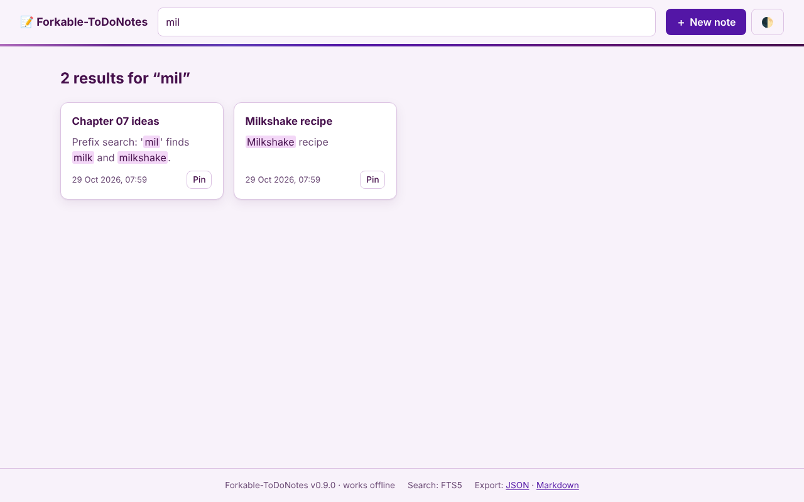
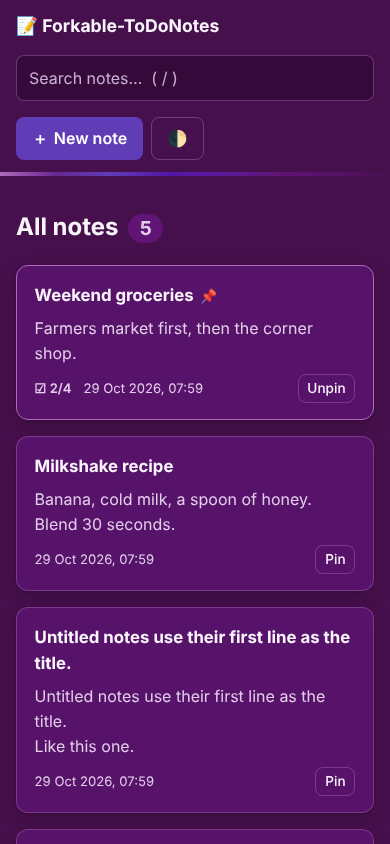

# 🎪 Chapter 09 · Playwright showcase — automation beyond clicking

> **Section 4 · Automation** · ⏱️ 90 min · 🏷️ checkpoint tag: `ch09`

## 🎯 Goal

Use Playwright for everything it is good at — not just "click and check". By the end, the suite
proves **seven** things about the app, and a script uses the same tool to photograph the UI for these docs.

## 🧠 The seven techniques

| # | Technique | Proves | Test file | Playwright feature |
|---|---|---|---|---|
| 1 | **User journeys** | create → edit → pin → delete works end to end | [`test_notes_crud.py`](../../tests/e2e/test_notes_crud.py) | page objects, `expect()` |
| 2 | **Wait for the network, not the clock** | ticking an item really goes through the API | [`test_checklist.py`](../../tests/e2e/test_checklist.py) | `page.expect_response()` |
| 3 | **JavaScript switched off** | the plain HTML path still works | [`test_checklist.py`](../../tests/e2e/test_checklist.py) | `new_context(java_script_enabled=False)` |
| 4 | **API + UI hybrids** | seed 20 notes in milliseconds, assert in the UI (and the reverse) | [`test_api_ui_hybrid.py`](../../tests/e2e/test_api_ui_hybrid.py) | `page.request` |
| 5 | **Offline proof** | not one request leaves `127.0.0.1` | [`test_offline.py`](../../tests/e2e/test_offline.py) | `context.route("**/*")` |
| 6 | **Search & keyboard** | prefix search, `<mark>` highlights, `/` shortcut, XSS stays text | [`test_search.py`](../../tests/e2e/test_search.py) | `keyboard.press`, `locator("mark")` |
| 7 | **Theme contract & autosave** | the palette really paints the page; typing saves itself | [`test_theme_and_autosave.py`](../../tests/e2e/test_theme_and_autosave.py) | `emulate_media()`, `to_have_css()`, `press_sequentially()` |

## 🗺️ Diagram — the guard in front of the network



## 🛠️ Build it — one technique at a time

### 1 · Wait for the network, not the clock

<!-- snippet: tests/e2e/test_checklist.py -->
```python
with page.expect_response(lambda r: "/api/items/" in r.url and r.request.method == "PATCH"):
    editor.item("passport").click()
expect(editor.item("passport")).to_be_checked()
expect(page.locator("#checklist-heading .count")).to_have_text("1/2")
```

The `with` block waits for **that exact** PATCH response. If `app.js` silently fell back to a
full-page form post, this test would fail — proving the enhancement really works.

### 2 · Progressive enhancement, verified

<!-- snippet: tests/e2e/test_checklist.py -->
```python
context = browser.new_context(java_script_enabled=False, base_url=base_url)
page = context.new_page()
```

Same click, no JavaScript: the form posts, the server redirects, the box is ticked.

### 3 · API + UI hybrids

<!-- snippet: tests/e2e/test_api_ui_hybrid.py -->
```python
for number in range(1, 21):
    response = page.request.post("/api/notes", data={"title": f"Note {number:02d}"})
    expect(response).to_be_ok()
home = HomePage(page).open()
expect(home.cards).to_have_count(20)
```

`page.request` shares the page's `base_url` and cookie jar, and a `dict` passed as `data=`
is sent as JSON. Seeding through the API keeps UI tests about the UI.

### 4 · Offline proof

<!-- snippet: tests/e2e/test_offline.py -->
```python
def guard(route: Route) -> None:
    host = urlsplit(route.request.url).hostname
    if host in {"127.0.0.1", "localhost"}:
        route.continue_()
    else:
        escaped.append(route.request.url)
        route.abort()

context.route("**/*", guard)
```

Then the test walks through every screen. One CDN font, one analytics beacon, one icon from
the internet, and `escaped` is no longer empty.

### 5 · The theme contract

<!-- snippet: tests/e2e/test_theme_and_autosave.py -->
```python
PLUM = "rgb(70, 16, 76)"  # #46104c, dark background
page.emulate_media(color_scheme="dark")
expect(page.locator("body")).to_have_css("background-color", PLUM)
```

`emulate_media` makes the browser *believe* the OS is in dark mode, so the test is repeatable on
any machine. `to_have_css` reads the **computed** colour — what is actually painted, after every
`var(--…)` is resolved.

### 6 · Typing like a human

<!-- snippet: tests/e2e/test_theme_and_autosave.py -->
```python
editor.body.press_sequentially("saved without clicking Save")
expect(editor.status).to_have_text(re.compile(r"^Saved ✓ "))
page.reload()
expect(editor.body).to_have_value("saved without clicking Save")
```

`fill()` sets the value in one go; `press_sequentially()` fires a key event per character —
needed here because autosave listens for typing.

### 7 · Automation for docs — [`scripts/capture_screenshots.py`](../../scripts/capture_screenshots.py)

The same tool, outside of tests: start the app on a throw-away database, fill it with demo notes,
photograph each screen in both themes and on a phone-sized viewport.

## 🖼️ The outcome

| 🌙 Dark | ☀️ Light |
|---|---|
|  |  |
|  |  |
|  |  |

<p align="center"></p>

## ▶️ Run it

<table>
<tr><th width="50%">🍎 macOS · Terminal (zsh)</th><th width="50%">🪟 Windows · PowerShell</th></tr>
<tr>
<td>

```bash
python -m pytest -m e2e -v                     # all browser tests
python -m pytest -m offline -v                 # just the offline proof
python -m pytest -m e2e --tracing retain-on-failure --screenshot only-on-failure
python scripts/capture_screenshots.py          # regenerate docs/assets/screenshots/
```

</td>
<td>

```powershell
python -m pytest -m e2e -v                     # all browser tests
python -m pytest -m offline -v                 # just the offline proof
python -m pytest -m e2e --tracing retain-on-failure --screenshot only-on-failure
python scripts/capture_screenshots.py          # regenerate docs/assets/screenshots/
```

</td>
</tr>
<tr><td colspan="2" align="center">✅ <b>Same command on both</b> — Git and pip behave identically here; only the shell differs.</td></tr>
</table>

When a test fails with tracing on, open its recording — every action, DOM snapshot and network call:

<table>
<tr><th width="50%">🍎 macOS · Terminal (zsh)</th><th width="50%">🪟 Windows · PowerShell</th></tr>
<tr>
<td>

```bash
python -m playwright show-trace test-results/*/trace.zip
```

</td>
<td>

```powershell
python -m playwright show-trace (Get-ChildItem test-results -Recurse -Filter trace.zip | Select-Object -First 1).FullName
```

</td>
</tr>
</table>

## 🌿 Git checkpoint

<table>
<tr><th width="50%">🍎 macOS · Terminal (zsh)</th><th width="50%">🪟 Windows · PowerShell</th></tr>
<tr>
<td>

```bash
git switch -c chapter/09-playwright-showcase
git add tests pyproject.toml
git commit -m "test(e2e): journeys, hybrids, offline proof, emulation and autosave"
git add scripts/capture_screenshots.py docs/assets/screenshots
git commit -m "docs: capture UI screenshots with Playwright"
git switch main
git merge --no-ff chapter/09-playwright-showcase -m "Merge chapter 09: Playwright showcase"
git tag -a ch09 -m "Chapter 09 checkpoint: Playwright showcase"
```

</td>
<td>

```powershell
git switch -c chapter/09-playwright-showcase
git add tests pyproject.toml
git commit -m "test(e2e): journeys, hybrids, offline proof, emulation and autosave"
git add scripts/capture_screenshots.py docs/assets/screenshots
git commit -m "docs: capture UI screenshots with Playwright"
git switch main
git merge --no-ff chapter/09-playwright-showcase -m "Merge chapter 09: Playwright showcase"
git tag -a ch09 -m "Chapter 09 checkpoint: Playwright showcase"
```

</td>
</tr>
<tr><td colspan="2" align="center">✅ <b>Same command on both</b> — Git and pip behave identically here; only the shell differs.</td></tr>
</table>

## 📝 Notes

> [!TIP]
> The online trace viewer at [trace.playwright.dev](https://trace.playwright.dev) opens a `trace.zip`
> **inside your browser**; Playwright's docs state it does not send the trace anywhere.

> [!IMPORTANT]
> `clean_db` empties the database before every test. Tests that depend on leftovers from other
> tests pass alone and fail in CI — the most common source of "flaky" suites.

> [!NOTE]
> Screenshots differ slightly between operating systems (fonts, anti-aliasing). That is why this
> course checks colours with `to_have_css` instead of comparing images pixel by pixel.

## 🧪 Your turn

1. Add an offline assertion for the **export** links: click "Markdown" and use `page.expect_download()` to check the file name ends in `.md`.
2. Add a phone-sized test (`viewport={"width": 390, "height": 844}`) checking the header is **not** sticky.
3. Make one test fail on purpose, run with `--tracing retain-on-failure`, and explore the trace.

## 📚 Sources

- Playwright — [Network (route, abort, continue)](https://playwright.dev/python/docs/network) · [APIRequestContext](https://playwright.dev/python/docs/api/class-apirequestcontext) (shared cookie jar, JSON `data`)
- Playwright — [Emulation](https://playwright.dev/python/docs/emulation) (`color_scheme`, viewport, `java_script_enabled`) · [Input](https://playwright.dev/python/docs/input) (`fill` vs `press_sequentially`) · [Keyboard](https://playwright.dev/python/docs/api/class-keyboard) (`ControlOrMeta`)
- Playwright — [Assertions](https://playwright.dev/python/docs/test-assertions) · [Screenshots](https://playwright.dev/python/docs/screenshots) · [Trace viewer](https://playwright.dev/python/docs/trace-viewer)

---

[⬅️ Chapter 08](chapter-08-playwright-foundations.md) · [📚 Learning path](../README.md) · **Next ➡️ [Chapter 10 · CI & releases](../section-5-ship-and-share/chapter-10-ci-and-releases.md)**
