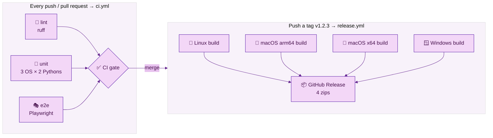

# 🚀 Chapter 10 · CI and releases

> **Section 5 · Ship & share** · ⏱️ 60 min · 🏷️ checkpoint tag: `ch10`

## 🎯 Goal

Every push and pull request is checked automatically on **macOS, Windows and Linux**, behind one
required check called **CI gate**. Pushing a version tag such as `v1.0.0` builds a
double-clickable app for each operating system and publishes them as a **GitHub Release**.

## 🧠 Concepts

| Idea | In one sentence |
|---|---|
| **Workflow** | A YAML file in `.github/workflows/` that GitHub runs on events like `push`. |
| **Job / step / runner** | A job is a list of steps on a fresh virtual machine (the *runner*). |
| **Matrix** | One job definition, many combinations: 3 operating systems × 2 Python versions = 6 jobs. |
| **Gate job** | One final job that passes only if *every* required job passed — the single check to require on `main`. |
| **Least privilege** | `permissions: contents: read` by default; only the release job may write. |
| **PyInstaller** | Bundles Python + your code + dependencies into one executable. It is **not a cross-compiler**: build each OS on that OS. |

## 🗺️ Diagram — two workflows



<sub>🖼️ Offline copy: [ci-pipeline.svg](../diagrams/ci-pipeline.svg) · source: [ci-pipeline.mmd](../diagrams/ci-pipeline.mmd)</sub>

## 🛠️ Build it

### 1 · CI — [`.github/workflows/ci.yml`](../../.github/workflows/ci.yml)

<!-- snippet: .github/workflows/ci.yml -->
```yaml
permissions:
  contents: read

concurrency:
  group: ${{ github.workflow }}-${{ github.ref }}
  cancel-in-progress: true

  unit:
    strategy:
      fail-fast: false   # show every OS/version result, not just the first failure
      matrix:
        os: [ubuntu-latest, macos-latest, windows-latest]
        python: ["3.10", "3.13"]
```

- **`concurrency`** cancels a now-pointless run when you push again to the same branch.
- **`fail-fast: false`** lets you see *all* failures, e.g. "only Windows + 3.10 fails".
- The **e2e** job runs on Linux only and uploads Playwright traces when something fails.

The gate:

<!-- snippet: .github/workflows/ci.yml -->
```yaml
ci-gate:
  name: CI gate
  needs: [lint, unit, e2e]
  if: always()   # run even when a needed job failed, so the gate can report it
```

`needs.<job>.result` is one of `success`, `failure`, `cancelled` or `skipped`; the gate fails
unless all three are `success`. In **Settings → Branches**, require only **CI gate** — then
adding a Python version to the matrix never breaks your branch protection.

### 2 · A double-clickable app — PyInstaller

[`packaging/launch.py`](../../packaging/launch.py) is a three-line entry script (PyInstaller needs a
plain script; pointing it at `__main__.py` would break the package imports). The build scripts:

<!-- snippet: scripts/build.sh -->
```bash
python -m PyInstaller \
  --noconfirm --clean \
  --onefile \
  --name ForkableToDoNotes \
  --collect-data todonotes \
  packaging/launch.py
```

`--collect-data todonotes` is the important line: it packs the templates, CSS and JS that live
*inside* the package, so the frozen app can still find them.

<table>
<tr><th width="50%">🍎 macOS · Terminal (zsh)</th><th width="50%">🪟 Windows · PowerShell</th></tr>
<tr>
<td>

```bash
./scripts/build.sh
./dist/ForkableToDoNotes            # run the frozen app
```

</td>
<td>

```powershell
.\scripts\build.ps1
.\dist\ForkableToDoNotes.exe        # run the frozen app
```

</td>
</tr>
</table>

### 3 · Releases — [`.github/workflows/release.yml`](../../.github/workflows/release.yml)

<!-- snippet: .github/workflows/release.yml -->
```yaml
on:
  push:
    tags: ["v*.*.*"]
- { os: ubuntu-latest,  label: linux-x64 }
- { os: macos-latest,   label: macos-arm64 }   # Apple Silicon
- { os: macos-15-intel, label: macos-x64 }     # Intel Macs
- { os: windows-latest, label: windows-x64 }
```

Each build runs `--version` on the fresh binary as a smoke test, zips it, and uploads it as an
artifact. A final job downloads all four and runs `gh release create … --generate-notes`.
Chapter tags (`ch00` … `ch11`) don't match `v*.*.*`, so they never trigger a release.

## ▶️ Run it — publish your copy

<table>
<tr><th width="50%">🍎 macOS · Terminal (zsh)</th><th width="50%">🪟 Windows · PowerShell</th></tr>
<tr>
<td>

```bash
git remote add origin https://github.com/YOUR-USER/Forkable-ToDoNotes.git
git push -u origin main
git push origin --tags                 # chapter tags + release tag
```

</td>
<td>

```powershell
git remote add origin https://github.com/YOUR-USER/Forkable-ToDoNotes.git
git push -u origin main
git push origin --tags                 # chapter tags + release tag
```

</td>
</tr>
<tr><td colspan="2" align="center">✅ <b>Same command on both</b> — Git and pip behave identically here; only the shell differs.</td></tr>
</table>

Cut a release later:

<table>
<tr><th width="50%">🍎 macOS · Terminal (zsh)</th><th width="50%">🪟 Windows · PowerShell</th></tr>
<tr>
<td>

```bash
git tag -a v1.1.0 -m "Forkable-ToDoNotes 1.1.0"
git push origin v1.1.0                 # triggers release.yml
```

</td>
<td>

```powershell
git tag -a v1.1.0 -m "Forkable-ToDoNotes 1.1.0"
git push origin v1.1.0                 # triggers release.yml
```

</td>
</tr>
<tr><td colspan="2" align="center">✅ <b>Same command on both</b> — Git and pip behave identically here; only the shell differs.</td></tr>
</table>

The status badge for your README (it is served by GitHub itself):

```markdown

```

## 🌿 Git checkpoint

<table>
<tr><th width="50%">🍎 macOS · Terminal (zsh)</th><th width="50%">🪟 Windows · PowerShell</th></tr>
<tr>
<td>

```bash
git switch -c chapter/10-ci-and-releases
git add .github/workflows
git commit -m "ci: lint, unit matrix, e2e and a single CI gate"
git add packaging scripts/build.sh scripts/build.ps1 requirements-dev.txt
git commit -m "build: PyInstaller one-file builds and release workflow"
git switch main
git merge --no-ff chapter/10-ci-and-releases -m "Merge chapter 10: CI and releases"
git tag -a ch10 -m "Chapter 10 checkpoint: CI and releases"
```

</td>
<td>

```powershell
git switch -c chapter/10-ci-and-releases
git add .github/workflows
git commit -m "ci: lint, unit matrix, e2e and a single CI gate"
git add packaging scripts/build.sh scripts/build.ps1 requirements-dev.txt
git commit -m "build: PyInstaller one-file builds and release workflow"
git switch main
git merge --no-ff chapter/10-ci-and-releases -m "Merge chapter 10: CI and releases"
git tag -a ch10 -m "Chapter 10 checkpoint: CI and releases"
```

</td>
</tr>
<tr><td colspan="2" align="center">✅ <b>Same command on both</b> — Git and pip behave identically here; only the shell differs.</td></tr>
</table>

## 📝 Notes

> [!WARNING]
> The downloaded apps are **not code-signed**. On **macOS**, the first launch is blocked: open
> **System Settings → Privacy & Security** and click **Open Anyway** (available for about an hour
> after the attempt). On **Windows**, Microsoft Defender SmartScreen may warn that the file is not
> commonly downloaded. Only run builds you downloaded from your own repository's Releases page.

> [!NOTE]
> `macos-latest` runners are Apple Silicon (arm64); Intel Macs get their own build from the
> `macos-15-intel` runner. Linux and Windows builds are x64.

> [!IMPORTANT]
> Every `uses:` line is pinned to a **full commit SHA**, with the version in a trailing comment
> (`uses: actions/checkout@3d3c42e… # v7.0.1`). A tag like `@v7` can be moved after you reviewed it;
> a SHA cannot. Dependabot reads the comment and proposes SHA + version updates weekly, and each
> one must pass the CI gate.

> [!TIP]
> A one-file app unpacks itself to a temporary folder on every start, so it takes a moment to open.
> Your notes are never inside the app — they stay in the per-user data folder from Chapter 03.

## 🧪 Your turn

1. Add Python `3.14` to the unit matrix. Does the gate still need changing? (No — that is the point.)
2. Add a CI step that runs `python scripts/check_contrast.py` in the lint job.
3. Build the app locally with the script for your OS and run `./dist/ForkableToDoNotes --version`.

## 📚 Sources

- GitHub Docs — [Workflow syntax](https://docs.github.com/en/actions/reference/workflows-and-actions/workflow-syntax) · [Matrix jobs](https://docs.github.com/en/actions/how-tos/write-workflows/choose-what-workflows-do/run-job-variations) · [Concurrency](https://docs.github.com/en/actions/how-tos/write-workflows/choose-when-workflows-run/control-workflow-concurrency) · [Contexts (`needs.*.result`)](https://docs.github.com/en/actions/reference/workflows-and-actions/contexts)
- GitHub Docs — [GitHub-hosted runners](https://docs.github.com/en/actions/reference/runners/github-hosted-runners) · [GitHub CLI in workflows](https://docs.github.com/en/actions/how-tos/write-workflows/choose-what-workflows-do/use-github-cli) · [Storing workflow data as artifacts](https://docs.github.com/en/actions/tutorials/store-and-share-data) · [Status badges](https://docs.github.com/en/actions/how-tos/monitor-workflows/add-a-status-badge)
- GitHub Docs — [About protected branches](https://docs.github.com/en/repositories/configuring-branches-and-merges-in-your-repository/managing-protected-branches/about-protected-branches) · [About releases](https://docs.github.com/en/repositories/releasing-projects-on-github/about-releases)
- GitHub CLI — [gh release create](https://cli.github.com/manual/gh_release_create)
- PyInstaller — [Using PyInstaller](https://pyinstaller.org/en/stable/usage.html) · [Requirements and "not a cross-compiler" (PyPI page)](https://pypi.org/project/pyinstaller/)
- Apple — [Open a Mac app from an unknown developer](https://support.apple.com/guide/mac-help/open-a-mac-app-from-an-unknown-developer-mh40616/mac) · Microsoft — [Microsoft Defender SmartScreen](https://learn.microsoft.com/en-us/windows/security/operating-system-security/virus-and-threat-protection/microsoft-defender-smartscreen/)

---

[⬅️ Chapter 09](../section-4-automation/chapter-09-playwright-showcase.md) · [📚 Learning path](../README.md) · **Next ➡️ [Chapter 11 · Fork, extend & audit](chapter-11-fork-extend-and-audit.md)**
